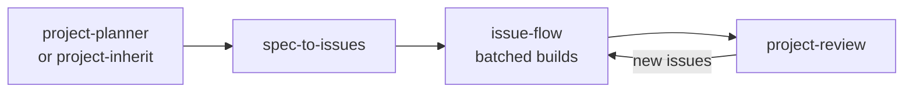

<p align="center">
  
</p>

<p align="center"><b>A Codex CLI port of the issue-flow plugin.</b> The same tracker-driven loop of a PM, workers, and merge gates, as a native Codex plugin.</p>

<p align="center">
  <a href="https://github.com/Crank-Git/issue-flow-codex/actions/workflows/ci.yml"></a>
  <a href="https://github.com/Crank-Git/issue-flow-codex/tags"></a>
  
  <a href="LICENSE"></a>
</p>

<p align="center">
  <a href="docs/how-it-works.md"><b>Docs</b></a> ·
  <a href="#install"><b>Install</b></a> ·
  <a href="#quick-start"><b>Quick start</b></a> ·
  <a href="https://github.com/Crank-Git/issue-flow-codex/tags"><b>Tags</b></a>
</p>



issue-flow is a Claude Code plugin by sniper7kills (Sniper7Kills LLC), released under the
MIT license. Its source is at
[Sniper7Kills-LLC/claude-plugins](https://github.com/Sniper7Kills-LLC/claude-plugins).
This repository is the Codex port. It tracks upstream tag `issue-flow--v0.21.0`, and
[`upstream.lock`](upstream.lock) records the port mode of each file.

## Why issue-flow-codex

I built this to use the same flow with Codex, or at least as similar a flow as we could
get.

A Claude Code PM and a Codex PM can work the same tracker as co-operators. The port
writes labels, comment markers, status issue titles, and branch names in the upstream
format, and keeps its Codex-only settings in a separate `.issue-flow.codex.json`.

The loop runs under the `issue_flow` permission profile, not `danger-full-access`. The
profile extends the workspace sandbox with `.git` writes and network access, so workers
can commit and push from their own worktrees. It applies only to a session you start
with `-p issue-flow`.

## Requirements

- **Codex CLI 0.166.0 or later.**
- **Python 3.11 or later**, for the setup script and the hooks. Standard library only.
- **git 2.5 or later**, for worktrees. Each worker gets its own worktree under
  `.worktrees/`.
- **`gh` or `tea`**, authenticated. On GitHub, `gh auth login` with the `repo` and
  `workflow` scopes: Epic 0 and `repo-mirror` push workflow files. On Gitea,
  `tea logins add` with a token that can write repositories and issues.
- **CI that honors `[skip ci]`.** GitHub Actions does, and Gitea Actions does from Gitea
  1.20.

The browser checks in Stage D and in `project-review` also want the `playwright` MCP
server. See [Optional integrations](docs/how-it-works.md#optional-integrations).

## Install

Add the marketplace at the release tag and install the plugin:

```bash
codex plugin marketplace add Crank-Git/issue-flow-codex --ref issue-flow-codex--v0.2.0
codex plugin add issue-flow@issue-flow-codex
```

Without `--ref`, Codex installs the default branch `dev`, which is not a release.

Start `codex`, then run `/hooks` and trust the issue-flow hooks. Codex skips plugin
hooks until you trust them.

Run the one-time setup in a terminal, outside Codex. `$issue-flow:setup` prints this
command with the absolute plugin path:

```bash
python3 <pluginRoot>/scripts/setup_project.py apply --user
```

This writes `issue-flow.config.toml` and the role files in `agents/` in `$CODEX_HOME`,
or in `~/.codex`. It doesn't change `config.toml`. To confirm, run the same script with
`check --user`. Each file reports `ok`, `missing`, or `stale`.

## Quick start

In each project, start Codex with the profile:

```bash
codex -p issue-flow -a never
```

Then start a skill:

```text
$issue-flow:project-planner <your idea>
```

`-a never` sets the approval policy for that session only. The planner interviews you,
writes `docs/specs/` and the project scaffold, and hands off to
`$issue-flow:spec-to-issues` once you approve the spec. Start the loop with
`$issue-flow:issue-flow`.

For a repository that already has code, start with `$issue-flow:project-inherit`
instead.

## Usage

Each upstream skill maps to one Codex invocation:

| Upstream skill | Codex invocation |
|---|---|
| `project-planner` | `$issue-flow:project-planner` |
| `project-inherit` | `$issue-flow:project-inherit` |
| `spec-update` | `$issue-flow:spec-update` |
| `spec-to-issues` | `$issue-flow:spec-to-issues` |
| `issue-flow` | `$issue-flow:issue-flow` |
| `project-review` | `$issue-flow:project-review` |
| `repo-mirror` | `$issue-flow:repo-mirror` |
| `setup` (Codex addition) | `$issue-flow:setup` |

After a plugin update, run `/hooks` to trust the hooks again, and run the setup command
again.

To keep the setup in one project instead, ask `$issue-flow:setup` for per-project mode.
It prints `.codex/` changes, and you apply them outside Codex.

### Known limits

- Codex doesn't wake an idle PM when a subagent finishes. The PM keeps its turn open
  with `wait_agent`.
- Plugin updates change the hook content hash. Run `/hooks` and trust the hooks again
  after an update.
- Codex project trust controls whether Codex reads the project's `.codex/` files.

## Documentation

| Page | What's there |
|---|---|
| [How it works](docs/how-it-works.md) | The loop, the seven skills, the batch model, deployment, run configuration, and usage reports, for Codex. |
| [Spec](docs/specs/spec.md) | The port's spec package: goals, terms, architecture, and one file per feature. |
| [Codex harness facts](docs/specs/pages/codex-harness.md) | Each Codex behavior the port depends on, with its evidence. |
| [Porting inventory](docs/specs/pages/porting-inventory.md) | The port mode of each upstream file and what changed. |
| [ADRs](docs/adr/) | Why a native plugin, a separate repo, the permission profile, the settings file, user-level setup, and the escalation role. |
| [Forge operations](references/forge.md) | Every tracker operation, mapped to `gh`, `tea`, and the Gitea MCP server. |

## Development

The scripts use the Python 3.11 standard library, so there's no install step. CI runs
these on every pull request into `dev` or `main`:

```bash
python3 -m unittest discover -s tests      # unit tests
python3 scripts/upstream_sync.py --check   # verbatim files match upstream.lock
python3 scripts/build_roles.py --check     # roles/*.toml are current with agents/*.md
python3 scripts/validate_manifests.py      # manifests, marketplace, skills, role files
```

The mirror filter tests need `git-filter-repo` on your `PATH` (`pip install
git-filter-repo`).

A scheduled workflow checks the upstream tags once a day and opens a `Sync upstream
<tag>` issue for a newer one. `python3 scripts/upstream_sync.py --to <tag>` then copies
the `verbatim` files and reports the diffs you port by hand. The port release version
is independent of the upstream version.

The release workflow tags a manifest version when it has no matching tag. This creates
the initial `issue-flow-codex--v0.1.0` tag when the workflow first runs on `main`.

## License

MIT. See [LICENSE](LICENSE). It keeps the upstream copyright line and adds one for the
port.

---

<sub>Part of <a href="https://github.com/Crank-Git#off-grid-and-everything-else"><b>Off-grid and everything else</b></a>. Siblings: <a href="https://github.com/Crank-Git/ATAK-Map-Downloader">ATAK-Map-Downloader</a> · <a href="https://github.com/Crank-Git/MTFWBuilder">MTFWBuilder</a> · <a href="https://github.com/Crank-Git/simpletetris">simpletetris</a> · <a href="https://github.com/Crank-Git/simplebubblebobble">simplebubblebobble</a> · Ported by <a href="https://github.com/Crank-Git">Crank</a></sub>
