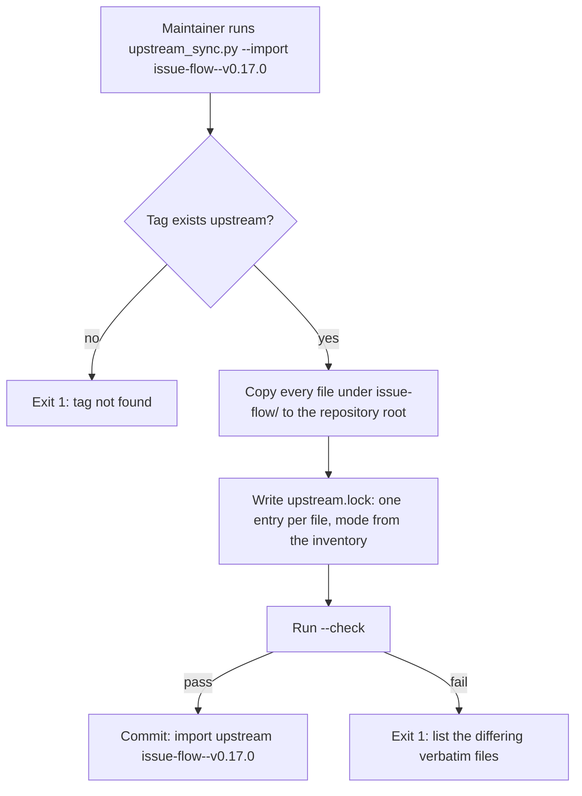
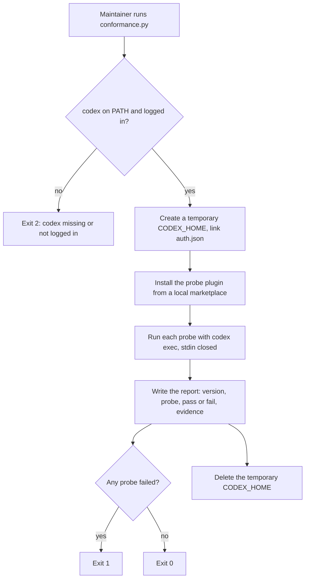

## Purpose

The foundation gives every later epic a repository to build in. It imports upstream
0.17.0 with a complete upstream lock. It adds the unit tests, the CI workflow, the
conformance suite, and the two test beds. After this epic, a worker can land in the
repository and run every check with one command.

## User stories

- As the maintainer, I want every upstream file imported at its upstream path, so that a later sync compares files one to one.
- As the maintainer, I want a lock that records the port mode of each file, so that the sync script knows which files it can copy.
- As the maintainer, I want a conformance suite, so that I know within one run if a Codex release breaks the port.
- As the operator, I want test beds on GitHub and Gitea, so that end-to-end runs never touch a real project.

## Functional requirements

- FR-foundation-1 — The repository holds every upstream file of `issue-flow/` at tag `issue-flow--v0.17.0`, at the same relative path, with the `issue-flow/` prefix removed.
- FR-foundation-2 — The repository holds `upstream.lock` at the root.
- FR-foundation-3 — `upstream.lock` records the upstream repository URL, the tag, and the commit SHA.
- FR-foundation-4 — `upstream.lock` holds one entry for each upstream file and for each port-only file.
- FR-foundation-5 — Each lock entry records `path`, `mode`, `upstream_sha256`, and `notes`.
- FR-foundation-6 — The initial lock sets each file's `mode` from the [porting inventory](../pages/porting-inventory.md).
- FR-foundation-7 — `scripts/upstream_sync.py --check` exits 0 when every `verbatim` file hashes equal to its upstream file.
- FR-foundation-8 — `scripts/upstream_sync.py --check` exits 1 and names each `verbatim` file that differs from upstream.
- FR-foundation-9 — The unit tests run with `python3 -m unittest discover -s tests`.
- FR-foundation-10 — The repository holds the upstream tests from `claude-plugins/scripts/test-*.py` under `tests/`, ported to the port's paths.
- FR-foundation-11 — A GitHub Actions workflow runs the unit tests, the manifest check, and the lock check on each pull request into `dev` and `main`.
- FR-foundation-12 — The repository has a `dev` branch, and `dev` is the default branch for pull requests.
- FR-foundation-13 — `scripts/conformance.py` runs each conformance probe in a new temporary `CODEX_HOME`.
- FR-foundation-14 — `scripts/conformance.py` links `auth.json` from the operator's `~/.codex` into the temporary `CODEX_HOME` and never copies it.
- FR-foundation-15 — `scripts/conformance.py` reports one line per probe: the probe id, `pass` or `fail`, and the evidence.
- FR-foundation-16 — The conformance suite holds the probes in the table under Behaviour rules.
- FR-foundation-17 — `scripts/conformance.py` records the Codex version in its report.
- FR-foundation-18 — `scripts/testbed-reset.py --forge github` returns the GitHub test bed to its seed state.
- FR-foundation-19 — `scripts/testbed-reset.py --forge gitea` returns the Gitea test bed to its seed state.
- FR-foundation-20 — The test bed seed state holds a small Python web app with tests, a CI workflow, the upstream labels, and five open issues in one epic.
- FR-foundation-21 — The repository holds `AGENTS.md`, `CLAUDE.md`, `.codex/`, and `.claude/` per the scaffold that the spec approval round accepted.
- FR-foundation-22 — `README.md` states the upstream project, its license, and its author, and links to the upstream repository.
- FR-foundation-23 — `LICENSE` holds the MIT license text with the upstream copyright line and the port copyright line.

## User flows

### Flow 1 — Import upstream



1. The maintainer runs `python3 scripts/upstream_sync.py --import issue-flow--v0.17.0`.
2. The script fetches the tag from the upstream repository.
3. If the tag does not exist, the script exits 1.
4. The script copies each file under `issue-flow/` to the same path without the prefix.
5. The script writes `upstream.lock`.
6. The script runs the check.
7. The maintainer commits the import.

### Flow 2 — Run the conformance suite



1. The maintainer runs `python3 scripts/conformance.py`.
2. If `codex` is not on the path, the script exits 2.
3. The script creates a temporary `CODEX_HOME` and links `auth.json`.
4. The script installs a probe plugin from a local marketplace.
5. The script runs each probe with `codex exec` and closes stdin.
6. The script writes the report to `conformance-report.md` and to stdout.
7. The script deletes the temporary `CODEX_HOME`.

## Screens & states

The feature has no screens. The conformance report is plain text:

```
codex-cli 0.166.0
P1  pass  plugin skill listed as issue-flow-probe:ping
P2  pass  SessionStart additionalContext reached the model
...
```

## Behaviour rules

### Conformance probes

| Id | Proves | Pass condition |
|---|---|---|
| P1 | Codex loads plugin skills with a namespace. | The model lists `<plugin>:ping`. |
| P2 | Codex runs plugin hooks with hook trust bypassed, and SessionStart context reaches the model. | The model repeats a token that only the hook output holds. |
| P3 | Codex skips an untrusted plugin hook in `codex exec`. | The hook log is empty without `--dangerously-bypass-hook-trust`. |
| P4 | V2 spawn of a custom role works, and the PM receives each verdict. | The model prints two JSON verdicts from two subagents. |
| P5 | The PreToolUse `tool_name` of a V2 spawn matches `spawn_agent$`, and `tool_input.agent_type` holds the role. | The hook log has the expected fields. |
| P6 | A PreToolUse deny blocks a spawn. | The subagent does not start, and the model reports the deny reason. |
| P7 | The default `workspace-write` sandbox blocks `.git` writes. | `git worktree add` fails. |
| P8 | The `issue_flow` permission profile allows worktree, commit, and network. | All three commands exit 0. |
| P9 | A subagent inherits the permission profile. | A subagent creates a worktree and commits. |
| P10 | Hooks fire inside a subagent with `agent_type` set. | The hook log has `agent_type` equal to the role. |
| P11 | `wait_agent` returns early when a subagent finishes. | The elapsed time is less than the `timeout_ms` value. |
| P12 | `followup_task` starts a new turn in an idle subagent. | The subagent returns a second verdict. |

### Lock rules

- `verbatim` — the file is byte-equal to upstream. The sync script copies it.
- `patched` — the file is upstream plus small port edits. The sync script writes the upstream diff to the change list.
- `rewritten` — the port rewrote sections of the file. The sync script writes the upstream diff to the change list.
- `dropped` — the port does not use the file. The sync script writes the upstream diff to the change list only if the file changed.
- `new` — the file exists only in the port. The sync script ignores it.

## Data touched

- `upstream.lock` (new): TOML. Top-level `repository`, `tag`, `commit`. Then one `[[file]]` table per entry.
- `conformance-report.md` (generated, ignored by git).
- Test bed repositories (remote).

## Interfaces

- **Codex CLI:** `codex exec` with `--json`, `-m`, `-s`, `-c`, `--dangerously-bypass-hook-trust`, and stdin closed. Verified against: `codex exec --help` (codex-cli 0.166.0). Note: `codex exec` has no `-a` flag. Set the approval policy with `-c approval_policy="never"`. Note: `codex exec` waits for stdin unless stdin is closed (measured 2026-11-03).
- **Codex plugin CLI:** `codex plugin marketplace add <path>`, `codex plugin add <name>@<marketplace>`. Verified against: `codex plugin --help` (0.166.0).
- **GitHub:** `gh repo create`, `gh label create`, `gh issue create`. Verified against: `gh help` at the version on the machine; the worker records the version in the PR.
- **Gitea:** `tea repo create`, `tea labels create`, `tea issues create`. Verified against: `tea --help`; the worker records the version in the PR. Upstream `references/forge.md` maps each operation.

## Edge cases & failures

- If the upstream tag moves, the lock still holds the old commit SHA. The check compares against the SHA, not the tag.
- If `codex` is not logged in, the conformance suite exits 2 before it runs a probe.
- If a probe times out, the report marks it `fail` with the evidence `timeout after <n> s`.
- If the test bed does not exist, `testbed-reset.py` creates it from the seed.
- If the Gitea server is down, `testbed-reset.py --forge gitea` exits 1 and names the URL.

## Acceptance criteria

- [ ] `python3 -m unittest discover -s tests` exits 0 on a fresh clone. (FR-foundation-9, FR-foundation-10)
- [ ] `python3 scripts/upstream_sync.py --check` exits 0 on a fresh clone. (FR-foundation-7)
- [ ] A change of one byte in a `verbatim` file makes `--check` exit 1 and name the file. (FR-foundation-8)
- [ ] `upstream.lock` holds one entry for each file under `issue-flow/` at the tag. (FR-foundation-1 to FR-foundation-6)
- [ ] A pull request into `dev` runs the CI workflow, and the workflow runs all three checks. (FR-foundation-11, FR-foundation-12)
- [ ] `python3 scripts/conformance.py` prints a pass line for P1 to P12 on Codex 0.166.0. (FR-foundation-13 to FR-foundation-17)
- [ ] After a conformance run, `~/.codex/config.toml` is byte-equal to its state before the run. (FR-foundation-14)
- [ ] `testbed-reset.py` returns each test bed to five open issues and no open pull requests. (FR-foundation-18 to FR-foundation-20)
- [ ] `README.md` names sniper7kills, the MIT license, and the upstream URL. (FR-foundation-22, FR-foundation-23)

## Out of scope

- The port does not run the conformance suite in CI, because it needs the operator's Codex login.
- The foundation does not port any skill text.

## Open questions
