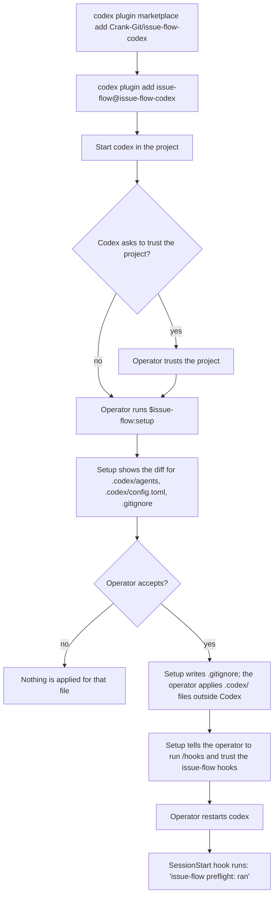
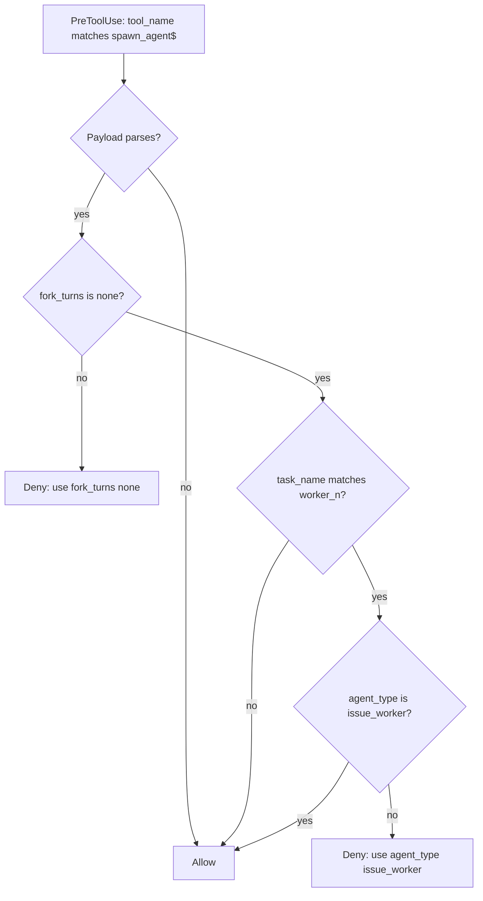
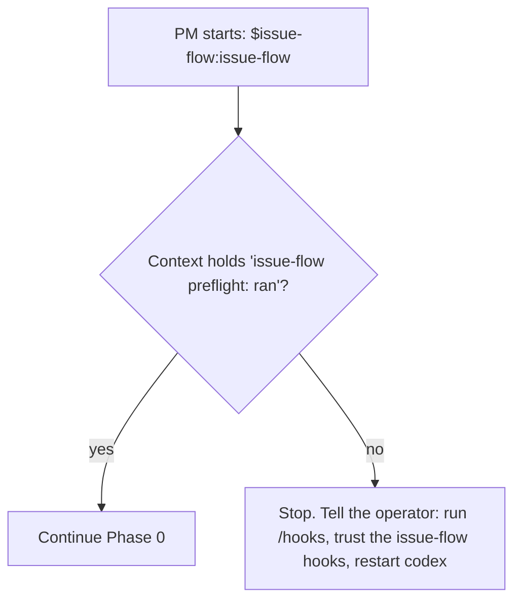

## Purpose

This feature makes the port installable. It ships the Codex manifest and the
marketplace file. It adds the setup skill, which configures one project for the loop.
It ports the two upstream hooks and adds the role guard.

## User stories

- As the operator, I want to install the plugin with two `codex plugin` commands, so that I do not copy files by hand.
- As the operator, I want one skill that configures my project, so that the roles, the thread limit, and the permission profile are correct before the first run.
- As the operator, I want the setup skill to show each change before it is applied, so that I control my Codex configuration.
- As the operator, I want the PM to stop when its hooks did not run, so that the loop never runs without its guards.
- As the maintainer, I want the spawn guard to deny the spawn shapes that are unsafe, so that the Codex loop keeps the upstream protection against a runaway worker.

## Functional requirements

### Package

- FR-plugin-packaging-1 — The plugin manifest is `.codex-plugin/plugin.json`.
- FR-plugin-packaging-2 — The manifest sets `name` to `issue-flow`.
- FR-plugin-packaging-3 — The manifest sets `skills` to `./skills` and `hooks` to `./hooks/hooks.json`.
- FR-plugin-packaging-4 — The manifest `version` follows semver and starts at `0.1.0`.
- FR-plugin-packaging-5 — The marketplace file is `.agents/plugins/marketplace.json`, with marketplace name `issue-flow-codex`.
- FR-plugin-packaging-6 — The marketplace entry sets `policy.installation`, `policy.authentication`, and `category`.
- FR-plugin-packaging-7 — `scripts/validate_manifests.py` exits 1 when a `SKILL.md` has no `description`.
- FR-plugin-packaging-8 — `scripts/validate_manifests.py` exits 1 when a path in the manifest does not start with `./`.
- FR-plugin-packaging-9 — `scripts/validate_manifests.py` exits 1 when a role file has a key that Codex ignores in a role: `sandbox_mode`, `approval_policy`, or `mcp_servers`.

### Setup skill

- FR-plugin-packaging-10 — The plugin ships the skill `setup`, started as `$issue-flow:setup`.
- FR-plugin-packaging-11 — The setup skill prints each file in `<pluginRoot>/roles/` as a role file for `<project>/.codex/agents/`. The operator applies the files with `python3 scripts/setup_project.py apply` from a shell outside the Codex sandbox. Nothing writes `.codex/` from inside a Codex session.
- FR-plugin-packaging-12 — The setup skill prints the config block for `<project>/.codex/config.toml` between the lines `# issue-flow:begin` and `# issue-flow:end`. The operator applies the block with `python3 scripts/setup_project.py apply` from a shell outside the Codex sandbox. Nothing writes `.codex/` from inside a Codex session.
- FR-plugin-packaging-13 — The setup skill changes no text outside the config block.
- FR-plugin-packaging-14 — The config block sets `[features.multi_agent_v2]` `max_concurrent_threads_per_session` to the run concurrency plus 4.
- FR-plugin-packaging-15 — The config block defines the permission profile `issue_flow` per Behaviour rules.
- FR-plugin-packaging-16 — The config block sets `default_permissions = "issue_flow"` only when the operator accepts that line.
- FR-plugin-packaging-17 — The setup skill shows the full diff of each file before the file is applied.
- FR-plugin-packaging-18 — The setup skill writes only files outside `.codex/`, and only after the operator accepts the diff. For a `.codex/` file, the operator applies the accepted diff outside Codex.
- FR-plugin-packaging-19 — The setup skill adds `.worktrees/` to `<project>/.gitignore` when the line is not present.
- FR-plugin-packaging-20 — The setup skill tells the operator to approve the plugin hooks with `/hooks`.
- FR-plugin-packaging-21 — The setup skill with the argument `check` reports each setup item as `ok`, `missing`, or `stale`, and writes no file.
- FR-plugin-packaging-22 — A role file in `.codex/agents/` is `stale` when its content differs from the plugin's copy.

### Hooks

- FR-plugin-packaging-23 — `hooks/hooks.json` registers `hooks/preflight.py` on `SessionStart`.
- FR-plugin-packaging-24 — `hooks/hooks.json` registers `hooks/guard-spawn.py` on `PreToolUse` with the matcher `spawn_agent$`.
- FR-plugin-packaging-25 — `hooks/hooks.json` registers `hooks/guard-role.py` on `PreToolUse` with the matcher `*`.
- FR-plugin-packaging-26 — The preflight hook output starts with the line `issue-flow preflight: ran <plugin version>`.
- FR-plugin-packaging-27 — The preflight hook keeps the upstream digest content.
- FR-plugin-packaging-28 — The preflight hook adds the line `issue-flow preflight: source=<source>` from the SessionStart `source` field.
- FR-plugin-packaging-29 — The spawn guard denies a spawn when `fork_turns` is not `"none"`. An omitted `fork_turns` means `"all"` and is denied.
- FR-plugin-packaging-30 — The spawn guard denies a spawn whose `task_name` matches `^worker_\d+(_c\d+)?$` when `agent_type` is not `issue_worker`.
- FR-plugin-packaging-31 — The spawn guard reads only `fork_turns`, `task_name`, and `agent_type`. It never reads `message`, because `message` arrives in the hook payload as an encrypted token.
- FR-plugin-packaging-32 — The spawn guard denies with `permissionDecision: "deny"` and a reason that states the correct call.
- FR-plugin-packaging-33 — The spawn guard allows every other spawn.
- FR-plugin-packaging-34 — The role guard reads its rules from `hooks/role-policy.json`.
- FR-plugin-packaging-35 — The role guard allows every call that has no `agent_type` in the payload.
- FR-plugin-packaging-36 — The role guard denies a call when the payload `agent_type` has a rule in `role-policy.json` and the call matches that rule.
- FR-plugin-packaging-37 — Each hook allows the call and exits 0 when its payload cannot be parsed.
- FR-plugin-packaging-38 — `ISSUE_FLOW_SPAWN_GUARD=off` disables the spawn guard. `ISSUE_FLOW_ROLE_GUARD=off` disables the role guard.
- FR-plugin-packaging-39 — The plugin does not ship `scripts/peers.py`. Codex has no agent-team files for it to read.

## User flows

### Flow 1 — Install and configure



1. The operator runs `codex plugin marketplace add Crank-Git/issue-flow-codex`.
2. The operator runs `codex plugin add issue-flow@issue-flow-codex`.
3. The operator starts `codex` in the project.
4. If Codex asks to trust the project, the operator trusts it. Codex loads the project `.codex/` layer only for a trusted project.
5. The operator runs `$issue-flow:setup`.
6. The setup skill shows the diff for each file.
7. If the operator accepts a diff, the setup skill writes `.gitignore`. For the `.codex/` files, the operator runs `python3 scripts/setup_project.py apply` from a shell outside Codex, because the session keeps `.codex/` read-only.
8. The setup skill tells the operator to run `/hooks` and trust the issue-flow hooks.
9. The operator starts a new `codex` session.

### Flow 2 — Spawn guard decision



1. Codex calls the spawn guard before each `spawn_agent` call.
2. If the payload does not parse, the guard allows the call.
3. If `fork_turns` is not `"none"` (or is omitted), the guard denies the call.
4. If `task_name` matches `^worker_\d+(_c\d+)?$` and `agent_type` is not `issue_worker`, the guard denies the call.
5. Else the guard allows the call.

### Flow 3 — Hook check at session start



1. The PM looks for the line `issue-flow preflight: ran` in its context.
2. If the line is not there, the PM stops and tells the operator to trust the hooks.
3. Else the PM continues Phase 0.

## Screens & states

The feature has no screens. The setup skill prints text. The `check` argument prints:

```
roles        ok       6 of 6 match plugin 0.1.0
config block ok
threads      ok       max_concurrent_threads_per_session = 7
profile      missing  default_permissions is not set to issue_flow
gitignore    ok
hooks        unknown  run /hooks to see the trust state
```

## Behaviour rules

### The config block

```toml
# issue-flow:begin (written by $issue-flow:setup — edit with the setup skill)
default_permissions = "issue_flow"

[features.multi_agent_v2]
enabled = true
max_concurrent_threads_per_session = 7

[permissions.issue_flow]
extends = ":workspace"

[permissions.issue_flow.filesystem.":workspace_roots"]
"." = "write"
".git" = "write"
".agents" = "write"

[permissions.issue_flow.network]
enabled = true
# issue-flow:end
```

- A root key in TOML must come before the first table header. The setup skill puts `default_permissions` at the top of the file when the file has other tables. The live test failed with "config defines `[permissions]` profiles but does not set `default_permissions`" when the key came after a table.
- The block does not set `[agents]` keys. V2 ignores `max_depth`.

### Role policy

| Role | Denied |
|---|---|
| `code_auditor` | `apply_patch`; `mcp__playwright__.*`; `Bash` commands that start with `git commit`, `git push`, `gh issue`, `gh pr`, `tea`. |
| `review_scribe` | `mcp__playwright__.*`; `Bash` commands that start with `git push --force`, `gh pr merge`, `tea pr merge`. |
| `deploy_verifier` | `apply_patch`; `Bash` commands that start with `git commit`, `git push`. |
| `ux_explorer` | `apply_patch` outside its scratch directory; `Bash` commands that start with `git`. |
| `ci_watcher` | `apply_patch`; `spawn_agent`. |
| `issue_worker` | `spawn_agent` with `agent_type` `issue_worker`. |

The role guard is a guard, not a security boundary. A shell command can write a file
without `apply_patch`. The roles' instructions state the same limits.

## Data touched

- `<project>/.codex/agents/*.toml` (new files).
- `<project>/.codex/config.toml` (the block only).
- `<project>/.gitignore` (one line).
- `$CODEX_HOME/config.toml` `[hooks.state]` (written by Codex when the operator trusts the hooks, not by the port).

## Interfaces

- **Manifest fields:** `name`, `version`, `description`, `skills`, `hooks`, `interface`. Paths start with `./`. Verified against: source `codex-rs/core-plugins/src/manifest.rs:48-117,607-645` (commit `dbaead01`).
- **Hook payload, PreToolUse:** `tool_name`, `tool_input`, `agent_id`, `agent_type`, `cwd`. For a V2 spawn, `tool_name` is `collaborationspawn_agent` and `tool_input.agent_type` holds the role. Inside a subagent, `agent_type` holds the subagent's role. Verified against: live test 2026-11-03, Codex 0.166.0.
- **Hook output, deny:** `{"hookSpecificOutput":{"hookEventName":"PreToolUse","permissionDecision":"deny","permissionDecisionReason":"..."}}`. Codex rejects `"ask"`. Verified against: source `codex-rs/hooks/src/engine/output_parser.rs:441-510`.
- **Hook output, SessionStart:** `{"hookSpecificOutput":{"hookEventName":"SessionStart","additionalContext":"..."}}`. Verified against: live test (the model repeated the context token).
- **Hook environment:** `PLUGIN_ROOT` and `CLAUDE_PLUGIN_ROOT` hold the install path. Verified against: live test.
- **Matcher:** a string with only `[A-Za-z0-9_|]` is an exact match. Any other string is an unanchored regex. `spawn_agent$` is a regex. Verified against: source `codex-rs/hooks/src/engine/matcher.rs:12-40`.
- **Role file keys that Codex applies:** `developer_instructions`, `model`, `model_reasoning_effort`, `model_reasoning_summary`, `model_verbosity`, `personality`, `service_tier`, and feature or skill disables. Verified against: source `codex-rs/core/src/agent/role.rs:79-117`.
- **Docs:** https://learn.chatgpt.com/docs/hooks, https://learn.chatgpt.com/docs/agent-configuration/subagents, https://developers.openai.com/plugins/build/plugins (retrieved 2026-11-03).

## Edge cases & failures

- If the operator updates the plugin, Codex marks the hooks as modified and skips them. The PM stops at Flow 3 until the operator trusts them again.
- If `.codex/config.toml` does not exist, the setup skill creates it with the block only.
- If the block exists, the setup skill replaces the block and keeps the rest of the file.
- If the project is not trusted in Codex, the project `.codex/` layer does not load. The PM detects this at Phase 0 when the `issue_worker` role is missing from the spawn tool, and stops.
- If the payload has a `tool_input` that is a string, not an object, the hooks allow the call.

## Acceptance criteria

- [ ] `codex plugin marketplace add` and `codex plugin add issue-flow@issue-flow-codex` succeed on a clean `CODEX_HOME`. (FR-plugin-packaging-1 to 6)
- [ ] `codex` lists the skills as `issue-flow:<name>`. (FR-plugin-packaging-10)
- [ ] `validate_manifests.py` fails a test fixture for each rule in FR-plugin-packaging-7 to 9.
- [ ] The setup plan on an empty project covers six role files, the block, and the `.gitignore` line, and nothing else. `apply` writes exactly those files. (FR-plugin-packaging-11 to 19)
- [ ] Setup on a project with a user `config.toml` keeps every user line. (FR-plugin-packaging-13)
- [ ] `$issue-flow:setup check` reports `stale` after one byte changes in a role file, and writes no file. (FR-plugin-packaging-21, 22)
- [ ] With trusted hooks, a new session's context holds `issue-flow preflight: ran 0.1.0`. (FR-plugin-packaging-26)
- [ ] The spawn guard test denies a spawn with `fork_turns: "all"` and with `fork_turns` omitted, denies a worker `task_name` without `agent_type: "issue_worker"`, and allows a worker `task_name` with `issue_worker` and `"none"`. (FR-plugin-packaging-29 to 33)
- [ ] The role guard test denies `apply_patch` for `code_auditor` and allows it for `issue_worker`. (FR-plugin-packaging-34 to 36)
- [ ] Each hook allows the call for a payload of `not json`. (FR-plugin-packaging-37)
- [ ] With hooks not trusted, the PM stops before it reads the tracker. (Flow 3)

## Out of scope

- The port does not manage hook trust for the operator. Codex requires the operator's approval.
- The setup skill does not install MCP servers. Feature 05 covers the browser server.

## Open questions

- Resolved (#109, operator ruling): agents never write `.codex/`. The setup skill prints the `.codex/` changes, and the operator applies them outside Codex.
