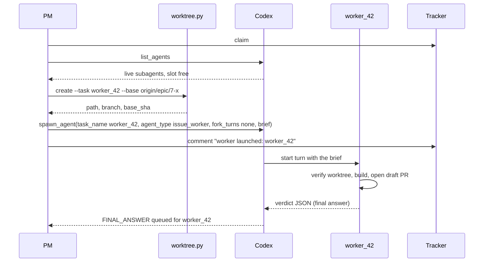
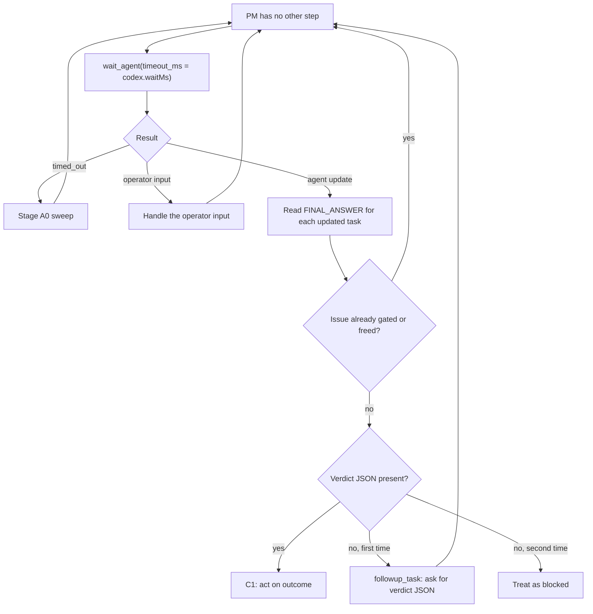
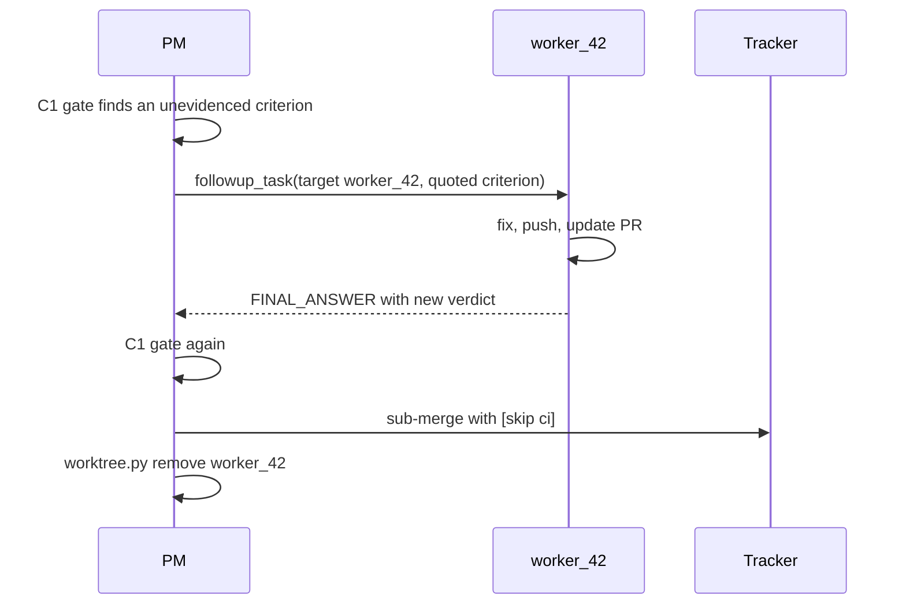
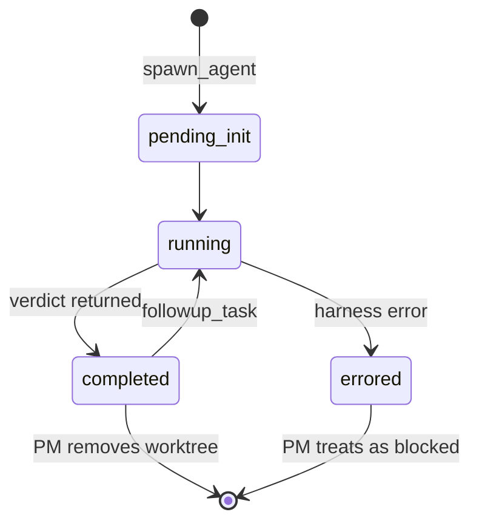

## Purpose

This feature ports upstream Stage B (launch) and Stage C1 (sub-merge gate) to Codex.
The PM creates a worktree for each issue, spawns a worker in it, waits for the
verdict, and gates the sub-PR. The tracker logic, the plan comment, the cross-check,
and the gate rules stay as upstream wrote them. Only the harness calls change.

## User stories

- As the operator, I want each worker to build in its own worktree, so that two workers never change the same checkout.
- As the operator, I want the PM to keep working while workers build, so that the loop runs workers in parallel.
- As the operator, I want rework to reach the same worker, so that the worker keeps its context of the issue.
- As the maintainer, I want the PM to own each worktree from creation to removal, so that no worktree is left behind.

## Functional requirements

### Worktrees

- FR-worker-dispatch-1 — `scripts/worktree.py create` creates a worktree at `<project>/.worktrees/<task_name>`.
- FR-worker-dispatch-2 — `scripts/worktree.py create` runs `git fetch <remote>` before it creates the worktree.
- FR-worker-dispatch-3 — `scripts/worktree.py create` creates the worktree on branch `issue/<n>-<slug>` from the `base` ref in the brief.
- FR-worker-dispatch-4 — `scripts/worktree.py create` copies each file that `<project>/.worktreeinclude` matches and that git ignores into the new worktree.
- FR-worker-dispatch-5 — `scripts/worktree.py create` prints one JSON line: `{"path": ..., "branch": ..., "base_sha": ...}`.
- FR-worker-dispatch-6 — `scripts/worktree.py remove` removes the worktree and deletes its local branch.
- FR-worker-dispatch-7 — `scripts/worktree.py remove` exits 1 and changes nothing when the worktree holds uncommitted or unpushed work.
- FR-worker-dispatch-8 — The PM creates the worktree before it spawns the worker.

### Spawn

- FR-worker-dispatch-9 — The PM spawns each worker with `agent_type: "issue_worker"` and `fork_turns: "none"`.
- FR-worker-dispatch-10 — The PM names each worker `task_name: "worker_<n>"`, where `<n>` is the issue number.
- FR-worker-dispatch-11 — The PM names a replacement worker after a checkpoint `worker_<n>_c<k>`, where `<k>` counts the checkpoints.
- FR-worker-dispatch-12 — The handoff brief holds every upstream brief field, plus `worktree: <absolute path>`.
- FR-worker-dispatch-13 — The worker runs every shell command with `workdir` set to the `worktree` path.
- FR-worker-dispatch-14 — The worker writes files only under the `worktree` path and its scratch directory.
- FR-worker-dispatch-15 — The worker returns `blocked` without work when the `worktree` path does not exist or is not on the brief's branch.
- FR-worker-dispatch-16 — The PM calls `list_agents` before each spawn and spawns only when a thread slot is free.
- FR-worker-dispatch-17 — The PM comments `worker launched: <task_name>` on the issue at launch.
- FR-worker-dispatch-18 — The PM spawns each locate subagent with `agent_type: "explorer"`, `fork_turns: "none"`, and model `gpt-6-luna`.

### Wait and verdicts

- FR-worker-dispatch-19 — The PM calls `wait_agent` when it has no other step to do and any subagent is live.
- FR-worker-dispatch-20 — The PM calls `wait_agent` with `timeout_ms` equal to the run configuration's `codex.waitMs`, default 600000.
- FR-worker-dispatch-21 — After a `wait_agent` timeout, the PM runs the upstream Stage A0 sweep, then waits again.
- FR-worker-dispatch-22 — The PM reads the verdict from the `FINAL_ANSWER` message that Codex queues for the worker's task name.
- FR-worker-dispatch-23 — The PM ignores a `FINAL_ANSWER` for an issue that it already gated or freed.
- FR-worker-dispatch-24 — When a `FINAL_ANSWER` holds no verdict JSON, the PM sends one `followup_task` that asks for the verdict JSON.
- FR-worker-dispatch-25 — When the second answer holds no verdict JSON, the PM treats the outcome as `blocked`.
- FR-worker-dispatch-26 — When `list_agents` reports a worker as `errored`, the PM treats the outcome as `blocked` with the error text.
- FR-worker-dispatch-27 — The PM ends its turn only when the loop stops.

### Rework and checkpoints

- FR-worker-dispatch-28 — The PM sends rework to the same worker with `followup_task`, target `worker_<n>`.
- FR-worker-dispatch-29 — On a `checkpoint` verdict, the PM removes the old worktree, creates a new one from `<remote>/issue/<n>-<slug>`, and spawns `worker_<n>_c<k>`.
- FR-worker-dispatch-30 — The PM keeps the upstream checkpoint cap of 3 consecutive checkpoints.

### Gate and teardown

- FR-worker-dispatch-31 — The PM applies the upstream C1 sub-merge gate unchanged: threads, target branch, local checks, practices, acceptance criteria, conflicts, authority, and sweep.
- FR-worker-dispatch-32 — The PM runs `scripts/worktree.py remove` for an issue after its sub-merge.
- FR-worker-dispatch-33 — The PM keeps the worktree of a parked standalone issue when the worktree holds unpushed work, per upstream.

### Worker subagents

- FR-worker-dispatch-34 — A worker spawns its own subagents only with `fork_turns: "none"` and model `gpt-6-luna`.
- FR-worker-dispatch-35 — A worker tells each of its subagents the `worktree` path and the rule that it writes nothing outside that path.
- FR-worker-dispatch-36 — A worker spawns a subagent only when `list_agents` shows a free thread slot. Else the worker does the step itself.

## User flows

### Flow 1 — Launch one member

1. The PM claims the issue with the upstream compare-and-set steps.
2. The PM calls `list_agents`.
3. If no thread slot is free, the PM keeps the issue claimed and waits.
4. The PM runs `scripts/worktree.py create`.
5. The PM spawns the worker with the brief.
6. The PM comments `worker launched: worker_42` on the issue.
7. The PM continues with the next step of the loop.

### Flow 2 — Wait and read a verdict

1. When the PM has no other step, it calls `wait_agent`.
2. If the wait times out, the PM runs the Stage A0 sweep and waits again.
3. If the operator typed input, the PM handles the input.
4. If a subagent sent an update, the PM reads each `FINAL_ANSWER`.
5. If the issue is already gated or freed, the PM ignores the answer.
6. If the answer holds verdict JSON, the PM acts on the `outcome` per upstream C1.
7. If the answer holds no verdict JSON, the PM asks once with `followup_task`.
8. If the second answer holds no verdict JSON, the PM treats it as `blocked`.

### Flow 3 — Rework

1. The C1 gate finds a defect.
2. The PM sends the defect to `worker_42` with `followup_task`.
3. The worker fixes the defect and returns a new verdict.
4. The PM runs the gate again.
5. When the gate passes, the PM sub-merges and removes the worktree.

## Screens & states

The feature has no screens. A worker passes through these Codex states:

## Behaviour rules

- One issue has one worktree at a time.
- The PM never spawns a worker before the cross-check comment exists, per upstream Stage B step 4.
- The `concurrency` setting counts workers only. Locate subagents, worker subagents, and watchers use the extra thread slots that the setup skill adds.
- The PM never uses `send_message` for rework. `send_message` does not start a turn in an idle worker.
- The PM never uses `interrupt_agent` on a worker that holds uncommitted work. It asks the worker to commit with `followup_task` first.

## Data touched

- `.worktrees/<task_name>/` (created and removed).
- `.worktreeinclude` (read).
- Tracker: issue labels, assignees, comments, pull requests, per upstream.

## Interfaces

- **`spawn_agent`** (V2): `task_name` (lowercase letters, digits, underscores), `message`, `agent_type`, `fork_turns` (`all` or `none`), `model`, `reasoning_effort`. A full fork does not accept a model override. Verified against: source `codex-rs/core/src/tools/handlers/multi_agents_spec.rs:108-164` and `codex-rs/prompts/src/multi_agent_instructions.rs:10` (commit `dbaead01`); live test 2026-11-03.
- **`wait_agent`** (V2): `timeout_ms` (default 30000, minimum 10000, maximum 3600000). Returns `{message, timed_out}` and no content. The wait ends early on operator input. Verified against: source `multi_agents_spec.rs:303-313`; live test.
- **`followup_task`** (V2): `target`, `message`. Starts a turn when the target is idle. Verified against: source `multi_agents_spec.rs:236-263`. Conformance probe P12 confirms it live.
- **`list_agents`** (V2): `path_prefix`. Returns `{agents: [{agent_name, agent_status}]}`. Verified against: source `multi_agents_spec.rs:315-334`.
- **`FINAL_ANSWER`**: Codex queues the final answer of a subagent as a message to the parent, in the format `Message Type / Task name / Sender / Payload`. Verified against: source `codex-rs/core/src/agent/control/completion.rs:92-128`; live test (verdicts received).
- **`exec_command`**: `workdir` sets the working directory of one command. Verified against: source `codex-rs/core/src/tools/handlers/shell_spec.rs:14-80`.

## Edge cases & failures

- If `worktree.py create` fails because the branch exists, the script reuses the branch when it has no worktree. Else it exits 1, and the PM parks the issue as `blocked` with the error.
- If a worker ends with uncommitted work, `worktree.py remove` refuses. The PM sends `followup_task` that asks the worker to commit and push.
- If Codex unloads an idle worker to free a slot, `followup_task` reloads it. Codex keeps its state.
- If compaction drops the PM's memory of a live worker, Phase 0 recovery finds it with `list_agents` and the `worker launched:` comment (Feature 03).
- If two `FINAL_ANSWER` messages arrive for one worker, the PM acts on the latest one only.

## Acceptance criteria

- [ ] `worktree.py create` makes `.worktrees/worker_42` on `issue/42-x` from the given base, and prints the JSON line. (FR-worker-dispatch-1 to 5)
- [ ] `worktree.py create` copies `.env` into the worktree when `.worktreeinclude` lists it and git ignores it. (FR-worker-dispatch-4)
- [ ] `worktree.py remove` exits 1 on a worktree with an uncommitted file. (FR-worker-dispatch-7)
- [ ] On a test bed, the PM launches two workers, and each worker commits only in its own worktree. (FR-worker-dispatch-8 to 15)
- [ ] With concurrency 3 and four ready issues, the PM never has more than three workers live. (FR-worker-dispatch-16)
- [ ] The PM sub-merges both members of a two-member batch after their verdicts. (FR-worker-dispatch-19 to 22, 31)
- [ ] A worker that answers with prose and no JSON gets one follow-up, and then the issue is labeled `status:blocked`. (FR-worker-dispatch-24, 25)
- [ ] A rework request reaches the same worker, and the worker returns a second verdict. (FR-worker-dispatch-28)
- [ ] A checkpoint verdict leads to a new worker `worker_<n>_c1` in a new worktree on the same branch. (FR-worker-dispatch-29)
- [ ] After the batch, `git worktree list` shows no worktree for a merged issue. (FR-worker-dispatch-32)

## Out of scope

- The batch gate (C2), CI, and deployment watching are in Feature 03.
- The port does not change the verdict schema.

## Open questions
