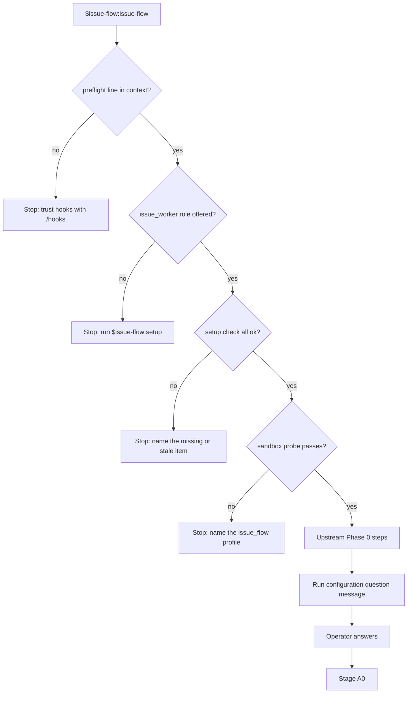
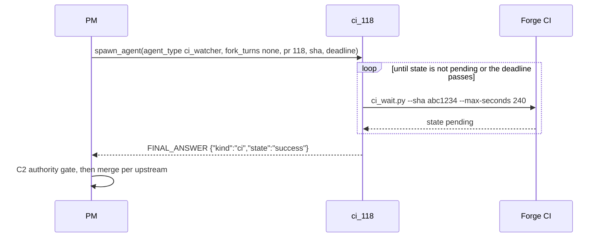
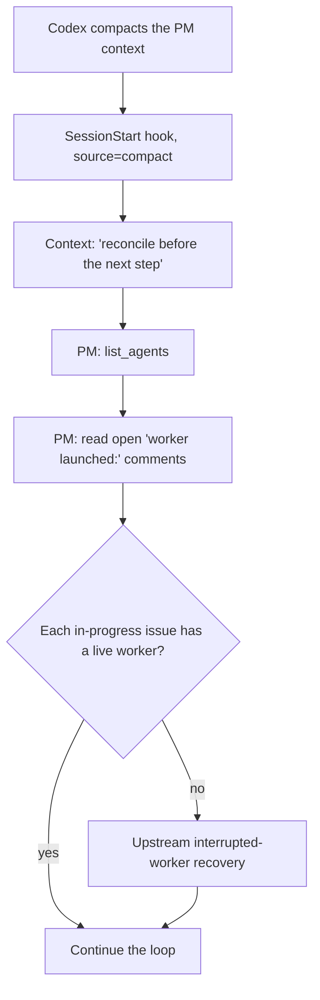

## Purpose

This feature ports the rest of the upstream PM loop to Codex: Phase 0 preflight, the
run configuration, the batch gate's CI run, the deployment watch, the digest, and the
recovery after compaction. It also keeps the tracker compatible with an upstream PM
that works the same tracker. Upstream waits for CI and deployments in a background
shell that notifies on exit. Codex has no such shell, so a watcher subagent does the
wait and returns a verdict.

## User stories

- As the operator, I want the PM to check its setup before it touches the tracker, so that a broken setup fails at the start, not in the middle of a batch.
- As the operator, I want to confirm the run configuration at each start, so that the PM never applies a saved answer without me.
- As the operator, I want CI and deployment waits to cost little, so that the loop does not spend top-model quota on polling.
- As the operator, I want the loop to continue after a compaction, so that one session can clear a large backlog.
- As a co-operator in Claude Code, I want the Codex PM to use the same labels and status issues, so that our two PMs do not undo each other's work.

## Functional requirements

### Phase 0

- FR-loop-operations-1 — Phase 0 runs the hook check of Feature 01 Flow 3 first.
- FR-loop-operations-2 — Phase 0 stops when the `spawn_agent` tool offers no `agent_type` value `issue_worker`, and tells the operator to run `$issue-flow:setup`.
- FR-loop-operations-3 — Phase 0 runs `$issue-flow:setup check` logic and stops on any `missing` or `stale` item.
- FR-loop-operations-4 — Phase 0 runs a sandbox probe: `git update-ref refs/issue-flow/probe HEAD`, then `git update-ref -d refs/issue-flow/probe`, then `git ls-remote <remote>`.
- FR-loop-operations-5 — Phase 0 stops when the sandbox probe fails, and names the permission profile `issue_flow`.
- FR-loop-operations-6 — Phase 0 keeps every other upstream Phase 0 step: repository, forge, labels, foundation check, branch model, deploy target, CI check, identity, co-operators, and state recovery.
- FR-loop-operations-7 — Phase 0 replaces each `claude mcp` step with the matching `codex mcp list` step.

### Run configuration

- FR-loop-operations-8 — The PM asks the upstream run configuration questions as one plain-text message with numbered options and the saved answers marked.
- FR-loop-operations-9 — The PM ends its turn after the question message and continues when the operator answers.
- FR-loop-operations-10 — The PM saves the answers to `.issue-flow.json` with the upstream keys.
- FR-loop-operations-11 — The PM saves Codex-only settings in `.issue-flow.codex.json` at the repository root. The file is committed and team-shared.
- FR-loop-operations-12 — `.issue-flow.codex.json` holds `version` and the flat keys `pmModel`, `workerModel`, `workerEffort`, `helperModel`, and `waitMs`. It has no nested `codex` object.
- FR-loop-operations-13 — The PM shows the models and the concurrency in the question message before the loop starts.

### Watchers

- FR-loop-operations-14 — The plugin ships the role `ci_watcher`, with model `gpt-6-luna`.
- FR-loop-operations-15 — `scripts/ci_wait.py` polls one CI run for one SHA for at most `--max-seconds`, default 240.
- FR-loop-operations-16 — `scripts/ci_wait.py` prints one JSON line `{"state": "pending" | "success" | "failure" | "missing", "url": ...}` and exits 0.
- FR-loop-operations-17 — `scripts/ci_wait.py` uses `gh` for GitHub and the upstream `gitea-ci-watch.sh` logic for Gitea.
- FR-loop-operations-18 — `scripts/deploy_wait.py` polls one deployment for one SHA for at most `--max-seconds`, default 240, with the upstream `deploy` modes `actions` and `command`.
- FR-loop-operations-19 — A watcher runs its wait script again while the state is `pending`, until its brief's deadline.
- FR-loop-operations-20 — A watcher returns the verdict `{"kind": "ci" | "deploy", "sha": ..., "state": ..., "url": ...}`.
- FR-loop-operations-21 — A watcher returns `state: "timeout"` when its brief's deadline passes.
- FR-loop-operations-22 — The PM spawns a watcher for each batch PR CI run, each standalone PR CI run, and each deployment that upstream watches.
- FR-loop-operations-23 — The PM names watchers `ci_<pr>` and `deploy_<sha7>`.
- FR-loop-operations-24 — The PM acts on a watcher verdict with the upstream rules for the matching CI or deployment outcome.
- FR-loop-operations-25 — On a standalone PR CI failure, the PM sends the failure to the PR's worker with `followup_task`.

### Digest and status

- FR-loop-operations-26 — The PM posts the upstream digest to its status issue, in the upstream format.
- FR-loop-operations-27 — The digest adds the line `harness: codex <version>`.
- FR-loop-operations-28 — The PM sends no push notification. The Codex CLI has no push notification tool.

### Recovery after compaction

- FR-loop-operations-29 — When the preflight hook runs with `source=compact`, it adds the line `issue-flow: context compacted — reconcile before the next step`.
- FR-loop-operations-30 — On that line, the PM calls `list_agents` and reads every open `worker launched:` comment before its next tracker write.
- FR-loop-operations-31 — The PM matches each live subagent to an issue by its task name.
- FR-loop-operations-32 — When the tracker shows an issue `status:in-progress` with no live worker, the PM uses the upstream recovery rules for an interrupted worker.
- FR-loop-operations-33 — When `list_agents` shows a live worker with no matching issue state, the PM sends `followup_task` that asks for the verdict.

### Compatibility

- FR-loop-operations-34 — The PM writes labels, comment markers, status issue titles, and branch names in the upstream 0.17.0 format.
- FR-loop-operations-35 — The PM reads `.issue-flow.json` files that upstream wrote, with no `.issue-flow.codex.json` beside them, and asks only the Codex-only questions.
- FR-loop-operations-36 — Phase 0 stops when the status issue for the same login has a digest from the last 30 minutes that this session did not write. The operator can confirm that the other session is gone, and the PM then continues.

## User flows

### Flow 1 — Phase 0 checks



1. The operator starts `$issue-flow:issue-flow`.
2. If the preflight line is missing, the PM stops.
3. If the `issue_worker` role is missing, the PM stops.
4. If the setup check finds a problem, the PM stops.
5. If the sandbox probe fails, the PM stops.
6. The PM runs the upstream Phase 0 steps.
7. The PM asks the run configuration questions and ends its turn.
8. The operator answers. The PM starts Stage A0.

### Flow 2 — CI watch for a batch PR



1. The PM opens the batch PR and spawns `ci_118`.
2. The watcher runs `ci_wait.py`.
3. While the state is `pending`, the watcher runs `ci_wait.py` again.
4. The watcher returns its verdict.
5. The PM acts on the verdict with the upstream C2 rules.

### Flow 3 — Recovery after compaction



1. Codex compacts the PM context.
2. The preflight hook adds the reconcile line.
3. The PM calls `list_agents`.
4. The PM reads the open `worker launched:` comments.
5. If an in-progress issue has no live worker, the PM applies the upstream recovery rules.
6. The PM continues the loop.

## Screens & states

The feature has no screens. The run configuration message has this shape:

```
issue-flow run configuration (saved answers marked *)

1. concurrency         * 3        (workers at once)
2. batchSize           * 4
3. runLength           * 25 issues
...
11. codex.workerModel  * gpt-6.1-sol, effort medium
12. codex.helperModel  * gpt-6-luna

Reply "ok" to accept all, or "<number>: <value>" for each change.
```

## Behaviour rules

- A watcher costs one thread slot for the length of its wait. The setup skill reserves one watcher slot (Feature 01).
- When no watcher slot is free, the PM waits for one before it opens the next batch PR. The PM never polls CI in its own context.
- A watcher brief holds a deadline, default 60 minutes for CI and 30 minutes for a deployment. These match the upstream watch limits.
- The PM keeps its turn open with `wait_agent` while any worker or watcher is live (Feature 02, FR-worker-dispatch-27).

## Data touched

- `.issue-flow.json`: upstream keys only, in the upstream format.
- `.issue-flow.codex.json`: the Codex-only settings.
- Status issue and digest comments, upstream format.

## Interfaces

- **SessionStart `source`:** `startup`, `resume`, `clear`, `compact`, or `fork`. Verified against: source `codex-rs/hooks/src/events/session_start.rs:24-40` (commit `dbaead01`); live test showed `startup`.
- **Compaction:** Codex queues a SessionStart with `source = "compact"` after compaction. Verified against: source `codex-rs/core/src/session/mod.rs:4783`. Conformance check is added in Epic 3: the end-to-end run forces a compaction with a low `model_auto_compact_token_limit`.
- **`exec_command` limits:** yield 250 ms to 30 s, and a default background timeout of 300 s. A watch script call longer than 300 s is not safe, so each wait script call ends within 240 s. Verified against: source `codex-rs/core/src/unified_exec/mod.rs:66-75`.
- **`request_user_input`:** available in Plan mode only, and never in `codex exec`. The PM uses a plain-text question instead. Verified against: source `codex-rs/tools/src/tool_config.rs:6-15`, `codex-rs/exec/src/lib.rs:2206-2215`.
- **GitHub CI:** `gh pr checks`, `gh run list --commit <sha> --json`. Verified against: `gh help` at the installed version, recorded by the worker in the PR. Upstream `references/forge.md` maps each operation.
- **Gitea CI:** the upstream `scripts/gitea-ci-watch.sh` API calls. Verified against: upstream `references/forge.md` and the Gitea API docs at the server version, recorded by the worker in the PR.

## Edge cases & failures

- If the operator answers the run configuration with an invalid value, the PM repeats the question for that item only.
- If a watcher errors, the PM spawns a new watcher once. On a second error, the PM labels the batch's tracking issue per the upstream rule for an unknown CI state.
- If CI never starts for the SHA, `ci_wait.py` returns `missing`, and the PM uses the upstream `verify_ci_ran.py` rule.
- If the PM's turn ends by accident while subagents are live, the next `$issue-flow:issue-flow` start runs Phase 0 recovery, which finds them with `list_agents`.
- If another session wrote the status issue for the same login within 30 minutes, Phase 0 stops and asks the operator to confirm that the other session is gone.

## Acceptance criteria

- [ ] With hooks not trusted, the PM stops before any tracker read. (FR-loop-operations-1)
- [ ] With the profile missing, the sandbox probe fails and the PM names `issue_flow`. (FR-loop-operations-4, 5)
- [ ] The run configuration message lists every upstream question and the five Codex keys. (FR-loop-operations-8 to 13)
- [ ] `ci_wait.py` returns `success` for a green SHA and `failure` for a red SHA on both test beds. (FR-loop-operations-15 to 17)
- [ ] A batch PR on a test bed merges after a `ci_watcher` verdict of `success`. (FR-loop-operations-22, 24)
- [ ] A standalone PR with a failing test gets a `followup_task` to its worker with the failure. (FR-loop-operations-25)
- [ ] The digest on the status issue holds `harness: codex 0.166.0`. (FR-loop-operations-26, 27)
- [ ] An end-to-end run with a forced compaction finishes its batch, and no issue is built twice. (FR-loop-operations-29 to 33)
- [ ] An upstream PM in Claude Code reads the Codex PM's labels and status issue without a parse error. (FR-loop-operations-34)
- [ ] The Codex PM runs on a project whose `.issue-flow.json` an upstream PM wrote. (FR-loop-operations-35)

## Out of scope

- The port does not add deployment provider integrations.
- The port does not add push notifications.

## Open questions

- Resolved: no upstream 0.17.0 code writes `.issue-flow.json` (`hooks/preflight.py` only reads it). An upstream PM rewrites the file from step 11 text in `skills/issue-flow/SKILL.md` and `references/session-config.md`, and that text has no rule to keep unknown keys. An upstream run can drop a `codex` key, so the port moves the settings to `.issue-flow.codex.json`.
