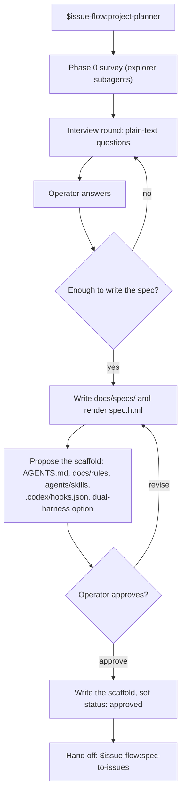

## Purpose

This feature ports the four skills that make and change a spec: `project-planner`,
`project-inherit`, `spec-update`, and `spec-to-issues`. The spec package format does
not change, and `render-spec.py` stays byte-equal to upstream. The project scaffold
changes, because Codex reads `AGENTS.md` and `.codex/`, not `CLAUDE.md` and
`.claude/`. Codex has no path-scoped rule files, so the rules move to `docs/rules/`
and the brief carries their paths.

## User stories

- As the operator, I want to plan a new project in Codex, so that I do not need Claude Code to start a project.
- As the operator, I want the scaffold to work in both harnesses, so that a Claude Code co-operator can work the same project.
- As the operator, I want the spec package to be identical to the upstream format, so that `spec-to-issues` in either harness reads it.

## Functional requirements

### All four skills

- FR-spec-skills-1 — Each skill asks interview questions as plain-text messages with numbered options, at most four questions per message.
- FR-spec-skills-2 — Each skill ends its turn after a question message and continues when the operator answers.
- FR-spec-skills-3 — Each skill names other skills as `$issue-flow:<name>`.
- FR-spec-skills-4 — Each skill spawns survey subagents with `agent_type: "explorer"`, `fork_turns: "none"`, and model `gpt-6-luna`.
- FR-spec-skills-5 — Each skill spawns survey subagents only when `list_agents` shows a free thread slot.
- FR-spec-skills-6 — Each skill keeps the upstream rules for STE, external APIs, review rounds, and approval.

### Scaffold

- FR-spec-skills-7 — The planner writes `AGENTS.md` at the project root.
- FR-spec-skills-8 — `AGENTS.md` holds the upstream `CLAUDE.md` content: summary, stack, layout, commands, conventions, spec pointer, filing gate, and changelog bound.
- FR-spec-skills-9 — `AGENTS.md` and every nested `AGENTS.md` together stay under 24 KiB. Codex truncates project docs above 32 KiB total.
- FR-spec-skills-10 — The planner writes `docs/rules/ste.md`, `docs/rules/quality.md`, and `docs/rules/external-apis.md` with the upstream rule content.
- FR-spec-skills-11 — `AGENTS.md` lists each file in `docs/rules/` and states when a reader must read it.
- FR-spec-skills-12 — The planner writes the project skills `run` and `test` at `.agents/skills/<name>/SKILL.md`.
- FR-spec-skills-13 — The planner writes project hooks to `.codex/hooks.json`, with the upstream hook safety rules.
- FR-spec-skills-14 — The planner does not write a permission allow-list. The `issue_flow` permission profile from the setup skill replaces it.
- FR-spec-skills-15 — When the operator selects dual-harness mode, the planner also writes `CLAUDE.md` with the single line `@AGENTS.md`.
- FR-spec-skills-16 — When the operator selects dual-harness mode, the planner also writes `.claude/rules/<name>.md` files that hold the upstream `paths:` front-matter and a pointer to `docs/rules/<name>.md`.
- FR-spec-skills-17 — The planner appends the `.gitignore` block with `.worktrees/`, `.issue-flow.local.json`, and, in dual-harness mode, the upstream Claude Code lines.
- FR-spec-skills-18 — The planner never overwrites an existing `AGENTS.md`, `CLAUDE.md`, `.codex/config.toml`, or `.gitignore`. It proposes additions and merges them on approval.
- FR-spec-skills-19 — The planner's checklist replaces each `CLAUDE.md` and `.claude/` item with its `AGENTS.md`, `docs/rules/`, `.agents/skills/`, or `.codex/` item.

### Brief

- FR-spec-skills-20 — The issue-flow PM passes `steRule` as `<project>/docs/rules/ste.md` when the file exists, else `<pluginRoot>/references/ste.md`.
- FR-spec-skills-21 — The issue-flow PM passes `qualityRule` as `<project>/docs/rules/quality.md` when the file exists.

### Unchanged parts

- FR-spec-skills-22 — `render-spec.py` stays byte-equal to upstream (`verbatim` in the lock).
- FR-spec-skills-23 — `spec-to-issues` writes the upstream issue body format and the upstream labels.
- FR-spec-skills-24 — `project-inherit` writes the upstream spec package format.
- FR-spec-skills-25 — `spec-update` keeps the upstream modes `change` and `refresh`.

## User flows

### Flow 1 — Plan a project in Codex

1. The operator starts `$issue-flow:project-planner`.
2. The planner surveys the repository with explorer subagents.
3. The planner asks one round of questions and ends its turn.
4. The operator answers. The planner asks more rounds while the spec needs product intent.
5. The planner writes the spec package and renders it.
6. The planner proposes the scaffold, including the dual-harness option.
7. If the operator asks for changes, the planner revises and renders again.
8. When the operator approves, the planner writes the scaffold and sets `status: approved`.
9. The planner names the next skill: `$issue-flow:spec-to-issues`.

## Screens & states

The feature has no screens. `spec.html` is the upstream renderer output and does not change.

## Behaviour rules

- A nested `AGENTS.md` replaces an upstream path-scoped rule when the rule applies to one directory, for example `src/api/AGENTS.md`. Codex reads every `AGENTS.md` from the project root down to the working directory.
- `docs/rules/` files are not loaded by Codex automatically. The brief and `AGENTS.md` carry their paths, and the worker reads them.
- Dual-harness mode is the default answer, because Goal 4 needs the project to work in both harnesses.

## Data touched

- `docs/specs/**` (upstream format).
- `AGENTS.md`, `docs/rules/*.md`, `.agents/skills/*/SKILL.md`, `.codex/hooks.json`, `.gitignore`.
- In dual-harness mode: `CLAUDE.md`, `.claude/rules/*.md`.

## Interfaces

- **AGENTS.md discovery:** Codex reads `AGENTS.md` files from the project root down to the working directory and concatenates them. The total limit is `project_doc_max_bytes`, default 32 KiB. Verified against: source `codex-rs/core/src/agents_md.rs:1-18`, `codex-rs/config/src/config_toml.rs:77` (commit `dbaead01`); https://learn.chatgpt.com/docs/agent-configuration/agents-md (retrieved 2026-11-03).
- **Repository skills:** Codex reads `.agents/skills/` in each directory from the working directory up to the project root. `SKILL.md` needs `description`. Verified against: source `codex-rs/ext/skills/src/host_roots.rs:112-170`, `codex-rs/skills/src/parser.rs:83-85`.
- **Project hooks:** `.codex/hooks.json` loads only when the project `.codex/` layer is trusted. Verified against: https://learn.chatgpt.com/docs/hooks (retrieved 2026-11-03).
- **`apply_patch` hook name:** a PostToolUse matcher `Write|Edit` also matches `apply_patch`. Verified against: source `codex-rs/core/src/tools/hook_names.rs:34-39`.
- **Claude Code import:** `@AGENTS.md` in `CLAUDE.md` imports the file. Verified against: upstream `skills/project-planner/references/scaffold.md` ("create `CLAUDE.md` containing `@AGENTS.md`").

## Edge cases & failures

- If the project already has a `CLAUDE.md` and no `AGENTS.md`, the planner proposes to move the content into `AGENTS.md` and to leave `@AGENTS.md` in `CLAUDE.md`. It moves nothing without approval.
- If `AGENTS.md` would pass 24 KiB, the planner moves detail into `docs/rules/` and keeps pointers in `AGENTS.md`.
- If an explorer subagent cannot start because no thread slot is free, the skill does the survey step in its own thread.

## Acceptance criteria

- [ ] `$issue-flow:project-planner` on an empty test project produces a spec package that `render-spec.py` renders with no error. (FR-spec-skills-1 to 6, 22)
- [ ] The scaffold holds `AGENTS.md`, three `docs/rules/` files, and two `.agents/skills/` skills. (FR-spec-skills-7 to 12)
- [ ] All `AGENTS.md` files together are under 24 KiB. (FR-spec-skills-9)
- [ ] In dual-harness mode, Claude Code started in the project loads `AGENTS.md` through `CLAUDE.md`. (FR-spec-skills-15)
- [ ] The planner on a project with an existing `AGENTS.md` changes no line of it without approval. (FR-spec-skills-18)
- [ ] `$issue-flow:spec-to-issues` creates issues that an upstream PM in Claude Code builds with no change. (FR-spec-skills-23)
- [ ] A worker brief carries `steRule` and `qualityRule` paths into `docs/rules/`. (FR-spec-skills-20, 21)
- [ ] `$issue-flow:project-inherit` and `$issue-flow:spec-update refresh` run on a test project and produce the upstream format. (FR-spec-skills-24, 25)

## Out of scope

- The port does not change the spec package format.
- The port does not convert existing `.claude/` scaffolds automatically.

## Open questions
