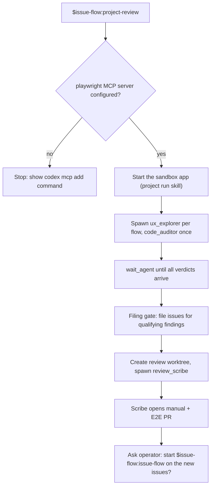

## Purpose

This feature ports `project-review` and its four roles: `ux_explorer`,
`deploy_verifier`, `review_scribe`, and `code_auditor`. The review PM starts the
project in a sandbox, sends browser subagents through user flows, sweeps the code,
files findings through the upstream filing gate, and lands a manual and E2E-test PR.
Codex cannot give a role its own MCP servers or tool list. The browser server is
configured once for all threads, and the role guard limits each role.

## User stories

- As the operator, I want a user-viewpoint review in Codex, so that the review step of the loop works in both harnesses.
- As the operator, I want the browser subagents to use Playwright, so that the review drives a real browser.
- As the operator, I want the read-only roles to stay read-only, so that a review never changes product code.

## Functional requirements

- FR-project-review-1 — The plugin ships role files for `ux_explorer`, `deploy_verifier`, `review_scribe`, and `code_auditor` in `roles/`.
- FR-project-review-2 — Each role file holds the upstream agent instructions in `developer_instructions`, with each Claude Code tool name replaced by its Codex tool name.
- FR-project-review-3 — Each role file sets `model` per the table in Behaviour rules.
- FR-project-review-4 — Before it spawns a browser role, the review PM checks with `codex mcp get playwright` that the server exists and sets `default_tools_approval_mode` to `approve`.
- FR-project-review-5 — When the check fails, the review PM shows the operator the command `codex mcp add playwright -- npx -y @playwright/mcp@<pinned version> --output-dir .worktrees/review/playwright-mcp` and the `default_tools_approval_mode = "approve"` key, and stops.
- FR-project-review-6 — The review PM never runs `codex mcp add` itself.
- FR-project-review-7 — Browser roles call the Playwright tools by their Codex names `mcp__playwright__<tool>`.
- FR-project-review-8 — The role guard applies the role policy of Feature 01 to the four roles.
- FR-project-review-9 — The review PM spawns each role with `fork_turns: "none"`.
- FR-project-review-10 — The review PM spawns at most as many browser roles at once as the free thread slots allow.
- FR-project-review-11 — The review PM reads each role's verdict from its `FINAL_ANSWER`, as Feature 02 defines.
- FR-project-review-12 — The review PM keeps every upstream phase, the filing gate, and the review branch rules.
- FR-project-review-13 — `ux_explorer` writes screenshots and walkthrough files only in its scratch directory under `.worktrees/review/<task_name>/`.
- FR-project-review-14 — The review PM creates the review branch worktree for `review_scribe` with `scripts/worktree.py create`.
- FR-project-review-15 — The issue-flow PM spawns `deploy_verifier` after a successful deployment watch, per upstream Stage D.

## User flows

### Flow 1 — Review run

1. The operator starts `$issue-flow:project-review`.
2. If the `playwright` server is missing or has no approval key, the review PM shows the fix and stops.
3. The review PM starts the app in a sandbox with the project's `run` skill.
4. The review PM spawns one `ux_explorer` per flow and one `code_auditor`.
5. The review PM waits for all verdicts.
6. The review PM files an issue for each finding that passes the filing gate.
7. The review PM creates the review worktree and spawns `review_scribe`.
8. The scribe opens the manual and E2E-test PR.
9. The review PM asks the operator whether to start the issue-flow loop.

## Screens & states

The feature has no screens of its own. The reviewed project's screens are the subject of the review.

## Behaviour rules

| Role | Model | Writes |
|---|---|---|
| `ux_explorer` | `gpt-6.1-sol` | Its scratch directory only. |
| `deploy_verifier` | `gpt-6-luna` | Nothing. |
| `review_scribe` | `gpt-6.1-sol` | `docs/manual/**` and E2E test files in the review worktree. |
| `code_auditor` | `gpt-6-luna` | Nothing. |

- Every thread in the session sees the `playwright` tools, because Codex gives each subagent the parent's MCP servers. The role guard denies `mcp__playwright__.*` for `code_auditor` and `review_scribe`.

## Data touched

- Tracker: finding issues, per the upstream filing gate.
- Review branch: `docs/manual/**`, E2E tests.
- `.worktrees/review/**` scratch files (ignored by git).

## Interfaces

- **MCP configuration:** `codex mcp add <NAME> -- <COMMAND>...`, `codex mcp list`, `codex mcp get <NAME>`. Verified against: `codex mcp --help` and `codex mcp get --help` (codex-cli 0.166.0). The approval key is `codex-harness.md` fact 22.
- **MCP tool names in hooks:** `mcp__<server>__<tool>`. Verified against: source `codex-rs/core/src/tools/handlers/mcp.rs:139-140` (commit `dbaead01`).
- **Roles and MCP:** a role file cannot set `mcp_servers`. Subagents inherit the parent's servers. Verified against: source `codex-rs/core/src/agent/role.rs:79-117`; https://learn.chatgpt.com/docs/agent-configuration/subagents (retrieved 2026-11-03).
- **Playwright MCP:** `@playwright/mcp`, pinned in the role files at the version the worker confirms from the package's README. The worker records the version and URL in the PR.

## Edge cases & failures

- If a finished subagent keeps its MCP server process alive (openai/codex issue #38247), the review PM ends the server processes at the end of the run with the project's `run` skill stop step.
- If the sandbox app does not start, the review PM stops and files nothing.
- If a browser role cannot reach the app, its verdict is `unreachable`, and the review PM reports it without a finding.

## Acceptance criteria

- [ ] With no `playwright` server, the review PM prints the `codex mcp add` command and spawns nothing. (FR-project-review-4 to 6)
- [ ] On a test bed, `ux_explorer` returns a walkthrough with at least one screenshot path. (FR-project-review-7, 13)
- [ ] `code_auditor` cannot change a file: the role guard denies its `apply_patch` call in a test. (FR-project-review-8)
- [ ] The review run files at least one seeded finding on the test bed and files no finding that the filing gate rejects. (FR-project-review-12)
- [ ] The scribe's PR holds a manual page and an E2E test that passes on the test bed. (FR-project-review-14)
- [ ] After a deployment watch, the issue-flow PM spawns `deploy_verifier` and records its verdict. (FR-project-review-15)

## Out of scope

- The port does not add a browser server other than Playwright.

## Open questions
