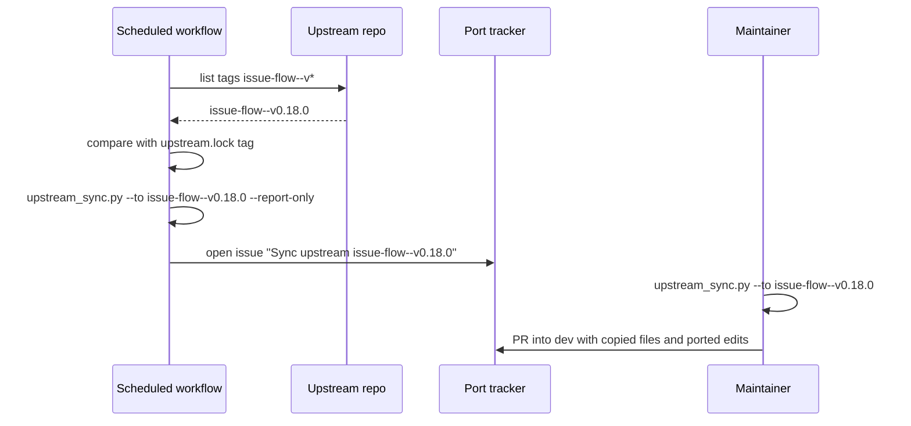

## Purpose

This feature ports `repo-mirror`, automates the upstream sync, and ships release
v0.1.0. After it, a new upstream release becomes a tracker issue in the port without
manual checks, and the port's own releases reach the marketplace.

## User stories

- As the maintainer, I want a scheduled job to tell me about a new upstream release, so that the port does not fall behind.
- As the maintainer, I want the sync to copy unchanged files and list the rest, so that I spend time only on the files the port changed.
- As the operator, I want `repo-mirror` in Codex, so that a private project can publish a public mirror.

## Functional requirements

### Sync

- FR-mirror-and-sync-1 — `scripts/upstream_sync.py --to <tag>` copies each `verbatim` file from the new tag.
- FR-mirror-and-sync-2 — `scripts/upstream_sync.py --to <tag>` writes `sync-report.md` with the upstream diff of each `patched`, `rewritten`, and changed `dropped` file.
- FR-mirror-and-sync-3 — `scripts/upstream_sync.py --to <tag>` lists each upstream file that is new since the old tag and has no lock entry.
- FR-mirror-and-sync-4 — `scripts/upstream_sync.py --to <tag>` updates `tag`, `commit`, and each `upstream_sha256` in `upstream.lock`.
- FR-mirror-and-sync-5 — `scripts/upstream_sync.py --to <tag>` writes nothing when the working tree has uncommitted changes.
- FR-mirror-and-sync-6 — A scheduled GitHub Actions workflow checks the upstream tags once a day.
- FR-mirror-and-sync-7 — When the workflow finds a tag `issue-flow--v*` newer than the lock's tag, it opens one tracker issue titled `Sync upstream <tag>`.
- FR-mirror-and-sync-8 — The workflow opens no second issue for a tag that already has one.
- FR-mirror-and-sync-9 — The sync issue body holds the `sync-report.md` content, in the upstream issue body format.

### repo-mirror

- FR-mirror-and-sync-10 — The `repo-mirror` skill excludes `AGENTS.md`, nested `AGENTS.md` files, `.codex/`, `.agents/`, and `docs/rules/` from the mirror, plus the upstream exclusions.
- FR-mirror-and-sync-11 — `mirror_filter.py` holds the new exclusions in its default list.
- FR-mirror-and-sync-12 — The `repo-mirror` skill keeps the upstream modes `setup`, `convert`, and `import`, and the upstream dry-run gate.

### Release

- FR-mirror-and-sync-13 — The release workflow tags `issue-flow-codex--v<version>` on a merge to `main` that changes the manifest `version`.
- FR-mirror-and-sync-14 — `README.md` documents install, setup, hook trust, the run command, and the known limits.
- FR-mirror-and-sync-15 — `README.md` holds a table that maps each upstream skill to its Codex invocation.

## User flows

### Flow 1 — Upstream release reaches the port

1. The scheduled workflow lists the upstream tags.
2. If a newer tag exists and has no issue, the workflow runs the sync in report-only mode.
3. The workflow opens the sync issue with the report.
4. The maintainer, or the issue-flow loop, runs the sync and ports the listed changes.
5. The change lands in `dev` by pull request.

## Screens & states

The feature has no screens.

## Behaviour rules

- The sync never edits a `patched` or `rewritten` file. A person or a worker ports those changes.
- The port version is independent of the upstream version. `README.md` states the upstream tag that each port release tracks.

## Data touched

- `upstream.lock`, `sync-report.md` (ignored by git).
- Tracker: one issue per upstream tag.
- `scripts/mirror_filter.py` default exclusions.

## Interfaces

- **Upstream tags:** `git ls-remote --tags https://github.com/Sniper7Kills-LLC/claude-plugins`. Tags use the form `issue-flow--v<semver>`. Verified against: `git ls-remote` on 2026-11-03 (latest `issue-flow--v0.17.0`).
- **GitHub Actions schedule:** `on: schedule: - cron:`. The worker confirms the syntax from https://docs.github.com/en/actions and records the URL in the PR.
- **Issue creation in CI:** `gh issue create` with `GITHUB_TOKEN` and `issues: write` permission. The worker confirms the permission name from the GitHub docs and records the URL in the PR.

## Edge cases & failures

- If upstream deletes a file that the lock lists, the report lists it, and the sync does not delete the port's file.
- If upstream renames a file, the report shows one deleted path and one new path.
- If the upstream repository is unreachable, the workflow fails and opens no issue.

## Acceptance criteria

- [ ] On a test fixture with two upstream tags, `--to` copies the changed `verbatim` file and lists the changed `rewritten` file in the report. (FR-mirror-and-sync-1, 2)
- [ ] A new upstream file with no lock entry appears in the report. (FR-mirror-and-sync-3)
- [ ] With an uncommitted change in the tree, `--to` exits 1 and writes nothing. (FR-mirror-and-sync-5)
- [ ] A second workflow run for the same tag opens no second issue. (FR-mirror-and-sync-7, 8)
- [ ] `mirror_filter.py` drops `AGENTS.md`, `.codex/`, `.agents/`, and `docs/rules/` in a test tree. (FR-mirror-and-sync-10, 11)
- [ ] `codex plugin marketplace add Crank-Git/issue-flow-codex` installs release v0.1.0. (FR-mirror-and-sync-13)
- [ ] `README.md` holds the skill mapping table and the hook trust step. (FR-mirror-and-sync-14, 15)

## Out of scope

- The port does not push changes upstream automatically.

## Open questions
