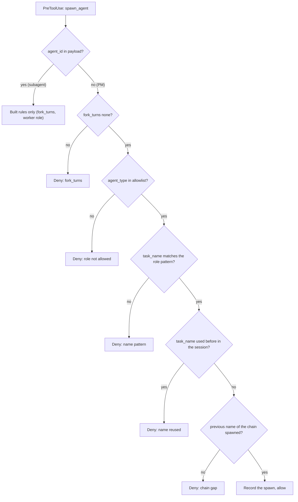
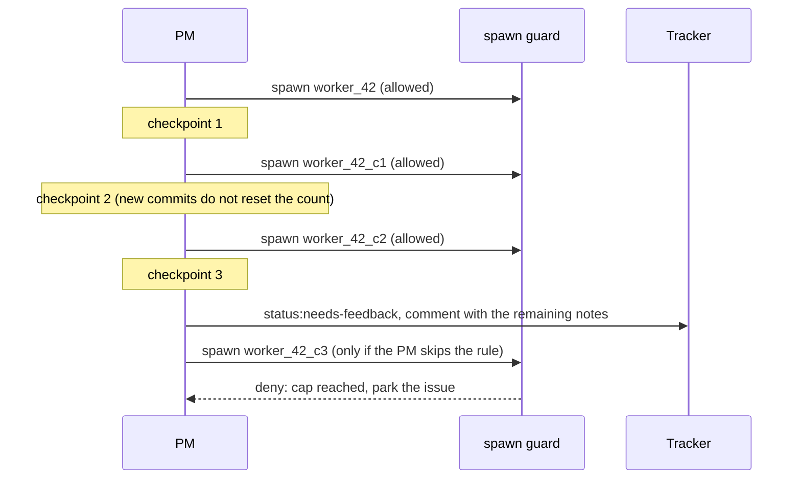

## Purpose

This feature puts hard limits on what the PM can spawn. It changes the built features
[Worker dispatch](02-worker-dispatch.md) and [Plugin packaging and hooks](01-plugin-packaging.md).

In the run that [Quota use of an operator run](../pages/spend-analysis.md) records, the
PM made up a phase plan, ended each phase with a worker checkpoint, and spawned about 400
subagents outside the plugin roles. The skill text forbade none of it in a form that a
hook could check. This feature moves the limits from prose into the spawn guard:

- The PM spawns only plugin roles, each with its own `task_name` pattern.
- One issue uses at most five workers.
- A worker builds the whole issue. It checkpoints only at its turn budget.
- The PM runs no test suite for one sub-issue. CI, or the no-CI fallback, runs once for
  each batch.

This feature is `port-only`. Upstream has no equivalent guard for the role set or the
worker count.

## User stories

- As the operator, I want the spawn guard to refuse a subagent outside the plugin roles, so that the PM cannot add agents that no rule limits.
- As the operator, I want a hard cap on the workers of one issue, so that a stuck issue goes to me instead of using quota for days.
- As the operator, I want one worker to build one whole issue, so that each issue pays the context cost of a new worker once.
- As the operator, I want full test suites to run once for each batch, so that the loop does not keep my laptop busy for hours.
- As the maintainer, I want each limit to be a hook rule with a unit test, so that a change to the skill text cannot remove it.

## Functional requirements

### Role allowlist

- FR-spawn-limits-1 — The spawn guard applies the allowlist rules (FR-spawn-limits-2 to 6) only to a payload that has no `agent_id`. A payload with `agent_id` comes from a subagent (codex-harness fact 19).
- FR-spawn-limits-2 — The spawn guard denies a PM spawn that has no `agent_type`.
- FR-spawn-limits-3 — The spawn guard denies a PM spawn whose `agent_type` is not in this set: `issue_worker`, `criteria_checker`, `ci_watcher`, `deploy_verifier`, `explorer`, `code_auditor`, `ux_explorer`, `review_scribe`.
- FR-spawn-limits-4 — The spawn guard denies a PM spawn whose `task_name` does not match the pattern of its `agent_type` in the table "Task names" below.
- FR-spawn-limits-5 — The spawn guard denies a PM spawn whose `task_name` an earlier PM spawn in the same session used.
- FR-spawn-limits-6 — The deny reason names the rule, the `agent_type`, the `task_name`, and the allowed pattern.
- FR-spawn-limits-7 — The spawn guard records each allowed PM spawn in `$PLUGIN_DATA/spawns-<session_id>.json` before it exits.
- FR-spawn-limits-8 — The spawn guard creates `$PLUGIN_DATA` when the directory does not exist (codex-harness fact 17).
- FR-spawn-limits-9 — The no-CI fallback of the batch gate spawns `suite_<n>` with `agent_type: "ci_watcher"`.
- FR-spawn-limits-10 — The `ci_watcher` role instructions describe a suite brief: run the given test command once in the given worktree, and return the watcher verdict with `kind: "suite"`.

### Worker cap

- FR-spawn-limits-11 — The worker `task_name` pattern allows exactly five names for one issue: `worker_<n>`, `worker_<n>_c1`, `worker_<n>_c2`, `worker_<n>_e1`, and `worker_<n>_e1_c1`. The two `_e1` names belong to the role `issue_worker_escalated`, and the cap of five counts both roles.
- FR-spawn-limits-12 — The spawn guard denies a worker name when the session has no spawn of its predecessor. `worker_<n>_c1` and `worker_<n>_e1` need `worker_<n>`. `worker_<n>_c2` needs `worker_<n>_c1`. `worker_<n>_e1_c1` needs `worker_<n>_e1`. `fix_<n>_2` needs `fix_<n>`, and `fix_<n>_<k>` needs `fix_<n>_<k-1>`.
- FR-spawn-limits-13 — The deny reason for a name past the cap tells the PM to label the issue `status:blocked` and to comment with the chain of `remaining` notes.
- FR-spawn-limits-14 — The PM counts checkpoints for each attempt without a reset. New commits on the PR do not reset the count.
- FR-spawn-limits-15 — When `worker_<n>_c2` returns `checkpoint`, the PM labels the issue `status:needs-feedback`. When the last `remaining` text names a hard blocker, the label is `status:blocked`.
- FR-spawn-limits-16 — When `worker_<n>_e1_c1` returns `checkpoint`, the PM labels the issue `status:blocked`.
- FR-spawn-limits-17 — `ISSUE_FLOW_SPAWN_GUARD=off` disables every rule of this feature, as it disables the built rules.

### Whole-issue workers

- FR-spawn-limits-18 — The PM gives each worker the whole issue in one brief.
- FR-spawn-limits-19 — The PM brief holds no phase limit, no "scratch-only" limit, and no instruction to wait for a later PM step.
- FR-spawn-limits-20 — The worker role returns `checkpoint` only when its turn budget is reached.
- FR-spawn-limits-21 — When a brief limits the worker to part of the issue, the worker builds the whole issue and states the conflict in `notesForPM`.
- FR-spawn-limits-22 — A `remaining` text names work that the next worker does. It never names a wait for the PM.
- FR-spawn-limits-23 — The PM never sends `send_message` to a worker. It sends rework and questions with `followup_task` only.
- FR-spawn-limits-24 — When an issue needs the browser, the PM launches its worker only when no other browser user is live. The PM decides this at launch, not during the build.

### Test runs

- FR-spawn-limits-25 — A worker runs the tests that its change touches while it builds.
- FR-spawn-limits-26 — A worker runs the project test command from `conventions` once, before it returns `ready-to-merge`.
- FR-spawn-limits-27 — The PM runs no test suite for one sub-issue. The criteria checker of [Criteria check](08-criteria-check.md) runs the test command once for each check.
- FR-spawn-limits-28 — The PM spawns `suite_<n>` once for each batch gate. It spawns `suite_<n>_r2` once more only after a fix for a suite failure is merged into the integration branch.

### Separate sessions

- FR-spawn-limits-29 — The last message of `project-planner`, `project-inherit`, `spec-to-issues`, and `spec-update` tells the operator to start a new Codex session for `$issue-flow:issue-flow`.
- FR-spawn-limits-30 — That message gives the start command `codex -p issue-flow -a never`.

## Task names

| `agent_type` | Allowed `task_name` for a PM spawn |
|---|---|
| `issue_worker` | `worker_<n>`, `worker_<n>_c1`, `worker_<n>_c2`, `fix_<n>`, `fix_<n>_<k>` |
| `issue_worker_escalated` | `worker_<n>_e1`, `worker_<n>_e1_c1` |
| `criteria_checker` | `check_<n>`, `check_<n>_2`, `check_<n>_3`, `check_<n>_4` |
| `ci_watcher` | `ci_<pr>`, `ci_<pr>_r2`, `deploy_<sha7>`, `deploy_<sha7>_r2`, `suite_<n>`, `suite_<n>_r2` |
| `deploy_verifier` | `verify_deploy_<sha7>` |
| `explorer` | `locate_<n>_<k>`, `docs_<n>`, `crosscheck_<n>`, `batchreview_<n>`, `survey_<k>`, `deploylog_<sha7>` |
| `code_auditor` | `code_auditor` |
| `ux_explorer` | `ux_<slug>` |
| `review_scribe` | `review_scribe`, `review_scribe_<k>`, `review_scribe_<slug>` |

`<n>`, `<pr>`, and `<k>` are decimal numbers. `<sha7>` is seven lowercase hexadecimal
characters. For `ux_<slug>`, `<slug>` is lowercase letters, digits, and underscores. For `review_scribe_<slug>`, `<slug>` is lowercase letters, digits, and hyphens. `fix_<n>` is the batch-gate fix worker, where `<n>` is the batch or epic tracking issue, and `<k>` of `fix_<n>_<k>` starts at 2.

## User flows

### Flow 1 — The spawn guard checks a PM spawn

1. Codex sends the `spawn_agent` payload to the spawn guard.
2. If the payload has `agent_id`, the guard applies only the built rules.
3. If `fork_turns` is not `"none"`, the guard denies the spawn.
4. If `agent_type` is absent or not in the allowlist, the guard denies the spawn.
5. If `task_name` does not match the role pattern, the guard denies the spawn.
6. If the session used `task_name` before, the guard denies the spawn.
7. If the chain has a gap, the guard denies the spawn.
8. Else the guard records the spawn and allows it.

### Flow 2 — One issue reaches the worker cap

1. The PM spawns `worker_42`. The worker returns `checkpoint`.
2. The PM spawns `worker_42_c1`. The worker returns `checkpoint` again.
3. The PM spawns `worker_42_c2`. The worker returns `checkpoint` a third time.
4. The PM labels the issue `status:needs-feedback` and comments with the `remaining` notes.
5. If the PM tries another spawn past the cap, the guard denies it.

An escalation (Feature 08) adds `worker_42_e1` and, after one checkpoint of that
worker, `worker_42_e1_c1`. One issue therefore uses at most five workers in a session.

## Screens & states

The feature has no screens.

## Behaviour rules

- The allowlist and the name patterns are constants in `hooks/guard-spawn.py`. They are not a setting.
- The guard keeps one state file for each PM session. It never reads the state of another session.
- The guard fails open on a parse error, as the built rules do. A missing or broken state file counts as an empty session.
- The `concurrency` setting still counts workers only.
- The five-name cap holds for each session. A new session can spawn `worker_<n>` again for an issue that a previous session parked. Phase 0 recovery reads the `worker launched:` comments, so the PM sees the earlier attempts.

## Data touched

- `$PLUGIN_DATA/spawns-<session_id>.json` (new): `{"names": ["worker_42", ...]}`.
- `hooks/guard-spawn.py`, `roles/issue-worker.toml` (from `agents/issue-worker.md`), `roles/ci-watcher.toml`, `skills/issue-flow/SKILL.md`, `skills/issue-flow/references/issue-worker.md`, the last step of the four spec skills.

## Interfaces

- **PreToolUse payload for `spawn_agent`:** `tool_input` has `task_name`, `fork_turns`, `message`, and `agent_type` only when the model set a role. `message` is encrypted. Verified against: codex-harness facts 6 and 13; `tests/fixtures/hooks/pre_tool_use_spawn.json`.
- **Subagent payloads:** a subagent payload has `agent_id` and `agent_type`, and shares the PM's `session_id`. Verified against: codex-harness fact 19.
- **`$PLUGIN_DATA`:** set for plugin hooks, not created by Codex. Verified against: codex-harness fact 17.

## Edge cases & failures

- If Codex rejects a spawn after the guard allows it, the name stays recorded. The PM uses the next name of the chain, or parks the issue. A rejected spawn is rare and costs one name.
- If two PM sessions run on one machine, each has its own state file, keyed by `session_id`.
- If the PM uses an old name format from an earlier session, for example `worker_42_c3`, the guard denies it and names the allowed pattern.
- If the state file cannot be written, the guard allows the spawn and writes one line to stderr. The guard fails open by design.

## Acceptance criteria

- [ ] A recorded PM spawn payload with `agent_type: "default"` gets a deny decision whose reason names the allowlist. (FR-spawn-limits-3, 6)
- [ ] A PM spawn with no `agent_type` and `task_name: "suite_12"` gets a deny decision. (FR-spawn-limits-2)
- [ ] A PM spawn `explorer` with `task_name: "review_12_sources"` gets a deny decision. (FR-spawn-limits-4)
- [ ] A subagent payload with `agent_id` and `agent_type: "default"` gets no allowlist deny. (FR-spawn-limits-1)
- [ ] A second PM spawn of `worker_42` in one session gets a deny decision. (FR-spawn-limits-5)
- [ ] `worker_42_c2` without an earlier `worker_42_c1` gets a deny decision. (FR-spawn-limits-12)
- [ ] `worker_42_c3` gets a deny decision whose reason tells the PM to label the issue `status:blocked`. (FR-spawn-limits-11, 13)
- [ ] After an allowed spawn, `$PLUGIN_DATA/spawns-<session_id>.json` lists its `task_name`, and the directory exists. (FR-spawn-limits-7, 8)
- [ ] With `ISSUE_FLOW_SPAWN_GUARD=off`, the payloads above get no output. (FR-spawn-limits-17)
- [ ] The issue-flow skill text spawns `suite_<n>` with `agent_type: "ci_watcher"`, and `test_skill_text.py` asserts it. (FR-spawn-limits-9)
- [ ] The worker role text states that `checkpoint` is valid only at the turn budget, and that a phase limit in a brief does not stop the build. (FR-spawn-limits-20, 21)
- [ ] The issue-flow skill text has no `send_message` instruction to a worker. (FR-spawn-limits-23)
- [ ] On the test bed, a two-member batch with no CI runs `suite_<n>` once, and no worker runs `ci_wait.py` or a suite for another member. (FR-spawn-limits-26 to 28)
- [ ] The last message of each of the four spec skills names `codex -p issue-flow -a never` and a new session. (FR-spawn-limits-29, 30)

## Out of scope

- The quota limit of a run is [Run budget and usage report](09-run-budget.md).
- The criteria check and the escalation are [Criteria check](08-criteria-check.md).
- A limit on `followup_task` calls. The hook payload shape of `followup_task` is not yet recorded.

## Open questions

- Does Codex reject a second `spawn_agent` with a `task_name` that a finished thread used? FR-spawn-limits-5 makes the answer unimportant for the cap. The conformance suite records it.
