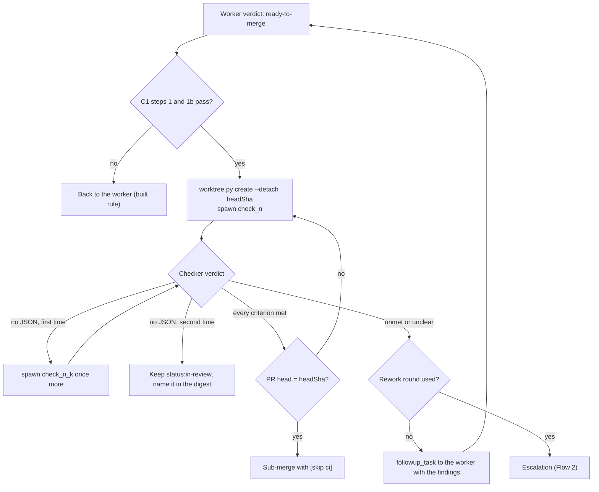
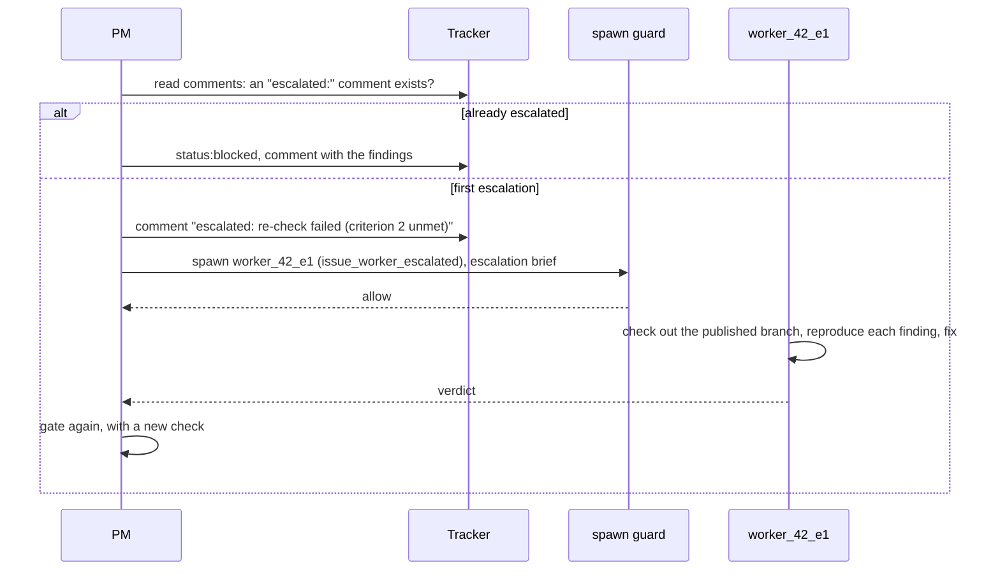

## Purpose

This feature syncs the port from upstream `issue-flow--v0.17.0` to `issue-flow--v0.21.0`.
It changes the built feature [Worker dispatch](02-worker-dispatch.md), Stage C1.

Upstream 0.18.0 to 0.20.0 added a workflow timeline and then removed it, so those
releases leave no change to port. Upstream 0.21.0 added three rules to the sub-merge
gate:

1. **An independent criteria check.** A read-only checker tests the branch against the
   acceptance criteria of the issue. It never sees the worker's verdict. Upstream
   measured a worker that changed 2 of the 3 files that its fix needed and still
   reported every criterion met.
2. **One rework round.** A criterion that the checker finds `unmet` or `unclear` goes back
   to the worker once. A second failure does not go back again.
3. **One escalation.** After a failed re-check, or a technical `blocked` verdict, the issue
   gets one more attempt by a stronger worker on the same branch.

In the run that [Quota use of an operator run](../pages/spend-analysis.md) records, the
PM sent work back to workers without a limit and added its own review agents. This
feature replaces those agents with one checker of a known cost, and puts a limit on the
rework.

Upstream file and section: `agents/criteria-checker.md` (new), `skills/issue-flow/SKILL.md`
Stage C1 steps 1c and "Escalation to Opus", `skills/issue-flow/references/issue-worker.md`
(the outcome table and the `escalation:` brief field), `agents/issue-worker.md`
("Escalation"), `hooks/guard-spawn.py` (the model guard), `references/worktrees.md`.

## User stories

- As the operator, I want a check that does not trust the worker's own claim, so that a partial fix does not merge.
- As the operator, I want rework to stop after one round, so that one issue cannot loop between the PM and its worker.
- As the operator, I want one stronger attempt before an issue is parked, so that a hard issue gets a fair try at a known cost.
- As the maintainer, I want the port on upstream 0.21.0, so that the next sync starts from a current base.

## Functional requirements

### Sync

- FR-criteria-check-1 — `upstream.lock` records the tag `issue-flow--v0.21.0` and its commit.
- FR-criteria-check-2 — Each `verbatim` file matches upstream 0.21.0, and `python3 scripts/upstream_sync.py --check` exits 0.
- FR-criteria-check-3 — Each `patched` and `rewritten` file that upstream changed between 0.17.0 and 0.21.0 carries the upstream change, ported to Codex.
- FR-criteria-check-4 — `upstream.lock` records `agents/criteria-checker.md` with mode `rewritten`, and its role file `roles/criteria-checker.toml`.
- FR-criteria-check-5 — `upstream.lock` records `scripts/pricing.json` with mode `dropped`, and the note "Codex plan quota has no price per token".
- FR-criteria-check-6 — `upstream.lock` records `scripts/usage.py` with mode `rewritten`. Feature 09 holds its requirements.
- FR-criteria-check-7 — `docs/specs/pages/porting-inventory.md` lists each new upstream file with its port mode.

### Criteria checker role

- FR-criteria-check-8 — The plugin ships the role `criteria_checker` in `roles/criteria-checker.toml`, built by `scripts/build_roles.py` from `agents/criteria-checker.md`.
- FR-criteria-check-9 — The role `criteria_checker` runs on model `gpt-6-luna` with effort `medium`.
- FR-criteria-check-10 — The role guard denies `apply_patch` to `criteria_checker`.
- FR-criteria-check-11 — The role guard denies these command prefixes to `criteria_checker`: `git commit`, `git push`, `git rebase`, `git reset`, `git stash`, `gh`, `tea`.
- FR-criteria-check-12 — The checker brief holds `issue`, `head`, `headSha`, `base`, `remote`, `testCommand`, `worktree`, and the numbered `criteria` quoted from the issue body.
- FR-criteria-check-13 — The checker brief never holds the worker's verdict, its `criteria`, or its `localChecks`.
- FR-criteria-check-14 — The checker returns the upstream verdict: `issue`, `head`, `headSha`, `criteria` with `status` `met`, `unmet`, or `unclear` and `evidence`, `testsRun`, and `notes`.

### Check worktree

- FR-criteria-check-15 — `scripts/worktree.py create --detach <sha>` creates a worktree at `<project>/.worktrees/<task_name>` with `HEAD` detached at `<sha>`, and creates no branch.
- FR-criteria-check-16 — The PM creates the check worktree before it spawns the checker, and removes it after the checker verdict.

### Gate

- FR-criteria-check-17 — When the C1 steps 1 and 1b pass, the PM spawns the checker with `agent_type: "criteria_checker"`, `fork_turns: "none"`, and `task_name: "check_<n>"`.
- FR-criteria-check-18 — The PM merges only the commit at the checker's `headSha`.
- FR-criteria-check-19 — When the PR head is not the checker's `headSha`, the PM runs a new check before the merge.
- FR-criteria-check-20 — When a criterion is `unmet` or `unclear`, the PM sends one rework round to the worker with `followup_task`. The message quotes each such criterion with its `status` and `evidence`.
- FR-criteria-check-21 — When the re-check after the rework round still has a criterion `unmet` or `unclear`, the PM escalates the issue.
- FR-criteria-check-22 — When a checker answer holds no verdict JSON, the PM spawns the checker once more with the next `check_<n>_<k>` name.
- FR-criteria-check-23 — When the second checker answer also holds no verdict JSON, the PM keeps the sub-issue `status:in-review` and names it in the next digest.
- FR-criteria-check-24 — A standalone or hotfix PR gets the same check, with `base` set to `dev`, before the `--squash` merge.

### Escalation

- FR-criteria-check-25 — The PM escalates on two triggers only: a failed re-check after the rework round, and a `blocked` verdict with a technical blocker.
- FR-criteria-check-26 — The PM never escalates a `needs-feedback` verdict or a `checkpoint` verdict.
- FR-criteria-check-27 — The PM escalates one issue at most once. When the issue already has an `escalated:` comment, the PM labels it `status:blocked`, comments with the findings, and frees the slot.
- FR-criteria-check-28 — Before the escalation spawn, the PM comments `escalated: <reason>` on the issue.
- FR-criteria-check-29 — The escalation spawn uses `task_name: "worker_<n>_e1"`, `agent_type: "issue_worker_escalated"`, and no `model` and no `reasoning_effort`. The role file `issue_worker_escalated` sets the model and the effort (`escalationModel` and `escalationEffort`).
- FR-criteria-check-30 — The escalation brief holds the original brief, `base: <remote>/issue/<n>-<slug>`, the PR number, and the field `escalation:` with the trigger and the checker findings or the `blocker`.
- FR-criteria-check-31 — The replacement of a checkpointed escalation worker is `worker_<n>_e1_c1`, with `agent_type: "issue_worker_escalated"` and the same `escalation:` field.
- FR-criteria-check-32 — `.issue-flow.codex.json` holds `escalationModel`, default `gpt-6.1-sol`, and `escalationEffort`, default `high`. The setup script writes both into the role file `issue-worker-escalated.toml`, and `workerModel` never reaches that file.
- FR-criteria-check-33 — The spawn guard denies a PM spawn of `issue_worker` or `issue_worker_escalated` that sets `model` or `reasoning_effort`. The reason says that Codex ignores a spawn model when the role file sets one, and names the escalation role.
- FR-criteria-check-34 — The spawn guard allows the names `worker_<n>_e1` and `worker_<n>_e1_c1` only with `agent_type: "issue_worker_escalated"`, and denies them with `issue_worker`. The role `issue_worker_escalated` has the same role policy as `issue_worker`.
- FR-criteria-check-35 — The worker role holds the upstream "Escalation" section: continue the published branch, read the findings before the code, and reproduce each finding first.

### Text

- FR-criteria-check-36 — The port uses the comment marker `escalated:` in place of the upstream `escalated to Opus:`, because the port escalates to a configured model.
- FR-criteria-check-37 — The PM skill text names the checker cost measured by the eval of Feature 10, not the upstream Sonnet cost.

## User flows

### Flow 1 — Gate one sub-issue with the checker

1. The worker returns `ready-to-merge`.
2. If C1 steps 1 or 1b fail, the work goes back to the worker by the built rule.
3. The PM creates a detached worktree at the PR head and spawns `check_<n>`.
4. If the checker returns no JSON once, the PM spawns the next check name.
5. If the checker returns no JSON twice, the PM keeps the sub-issue in review and names it in the digest.
6. If every criterion is `met` and the head did not move, the PM sub-merges.
7. If the head moved, the PM checks again.
8. If a criterion is `unmet` or `unclear` and the rework round is unused, the PM sends the findings to the worker.
9. If the rework round is used, the PM escalates.

### Flow 2 — Escalation

1. The PM reads the issue comments for an `escalated:` comment.
2. If the comment exists, the PM labels the issue `status:blocked` and comments with the findings.
3. Else the PM comments `escalated: <reason>`.
4. The PM spawns `worker_<n>_e1` with `agent_type: "issue_worker_escalated"` and the escalation brief.
5. The worker continues the published branch and returns a verdict.
6. The PM runs the whole gate again, with a new check.

## Screens & states

The feature has no screens.

## Behaviour rules

- A check costs one luna thread. The checker runs `testCommand` once.
- The rework round is one `followup_task` for each gate failure of the checker. The built rework rules for threads, practices, and conflicts stay as they are.
- The escalated worker gets no rework round. A failed gate of the escalated worker labels the issue `status:blocked`.
- The default escalation keeps the worker model and raises the effort, because the workers stay on `gpt-6.1-sol` until Feature 10 decides. If Feature 10 moves the workers to `gpt-6-luna`, the escalation default becomes `gpt-6.1-sol` at effort `medium`, the upstream pattern.

## Data touched

- `upstream.lock`, `docs/specs/pages/porting-inventory.md`.
- `agents/criteria-checker.md` (new upstream file), `roles/criteria-checker.toml` (new), `hooks/role-policy.json`, `hooks/guard-spawn.py`, `scripts/worktree.py`.
- `skills/issue-flow/SKILL.md`, `skills/issue-flow/references/issue-worker.md`, `skills/issue-flow/references/worktrees.md`, `skills/issue-flow/references/session-config.md`, `agents/issue-worker.md`, `roles/issue-worker.toml`, `README.md`.
- `.issue-flow.codex.json`: new keys `escalationModel` and `escalationEffort`. They set the role file `roles/issue-worker-escalated.toml`, built from `agents/issue-worker.md`.
- Tracker: the comment `escalated: <reason>`.

## Interfaces

- **`spawn_agent` `model` and `reasoning_effort`:** the V2 spawn accepts both, but Codex ignores them when the role file sets a model (codex-harness.md, fact 31). A full fork does not accept a model override. Verified against: source `codex-rs/core/src/tools/handlers/multi_agents_spec.rs:108-164` (commit `dbaead01`), Feature 02 Interfaces.
- **Upstream criteria checker:** `agents/criteria-checker.md` at `issue-flow--v0.21.0` (commit `f5eee9c`), brief and return contract.
- **Upstream escalation:** `skills/issue-flow/SKILL.md` at `issue-flow--v0.21.0`, Stage C1 "Escalation to Opus".

## Edge cases & failures

- The role file `model` wins over the spawn `model` (codex-harness.md, fact 31, probe P14 on 2026-11-22). The escalation therefore uses its own role, `issue_worker_escalated`. The conformance probe P14 now spawns a probe role whose file sets the escalation model, and it must report that model in the subagent rollout `turn_context.model`.
- If the checker cannot fetch `headSha`, it returns every criterion `unclear`. The PM treats that as a failed check.
- If the worktree for the check exists from an earlier session, `worktree.py create --detach` exits 1. The PM removes it with `worktree.py remove` first.

## Acceptance criteria

- [ ] `python3 scripts/upstream_sync.py --check` exits 0, and `upstream.lock` names `issue-flow--v0.21.0`. (FR-criteria-check-1, 2)
- [ ] `upstream.lock` lists `agents/criteria-checker.md` as `rewritten`, `scripts/pricing.json` as `dropped`, and `scripts/usage.py` as `rewritten`. (FR-criteria-check-4 to 6)
- [ ] `python3 scripts/build_roles.py --check` exits 0, and `roles/criteria-checker.toml` sets `model = "gpt-6-luna"`. (FR-criteria-check-8, 9)
- [ ] A recorded `apply_patch` payload of `criteria_checker` gets a deny decision from the role guard. (FR-criteria-check-10)
- [ ] `worktree.py create --detach <sha>` makes a worktree whose `git rev-parse HEAD` is `<sha>` and whose `git branch --show-current` is empty. (FR-criteria-check-15)
- [ ] The PM skill text spawns `check_<n>` with `agent_type: "criteria_checker"`, and its brief template has no `localChecks` field. (FR-criteria-check-12, 13, 17)
- [ ] A recorded PM spawn of `worker_42` with `model` set gets a deny decision, and so does `worker_42_e1` with `model` set. (FR-criteria-check-33)
- [ ] A recorded PM spawn of `worker_42_e1` with `agent_type: "issue_worker"` gets a deny decision. (FR-criteria-check-34)
- [ ] A conformance probe shows `turn_context.model` equal to the role file model in the rollout of a spawn of a role whose file sets the escalation model. (FR-criteria-check-29)
- [ ] On the test bed, a seeded sub-issue whose worker fixes only part of a criterion gets an `unmet` check, one rework message, and no merge before a re-check passes. (FR-criteria-check-18 to 21)
- [ ] On the test bed, a second failed re-check produces one `escalated:` comment and a `worker_<n>_e1` spawn. (FR-criteria-check-21, 28, 29)

## Out of scope

- The worker model decision is Feature 10.
- The upstream eval harness for the PM suite. Feature 10 ports the worker and checker cases only.

## Open questions

- Resolved: the role file `model` takes precedence over the spawn `model` (fact 31).
