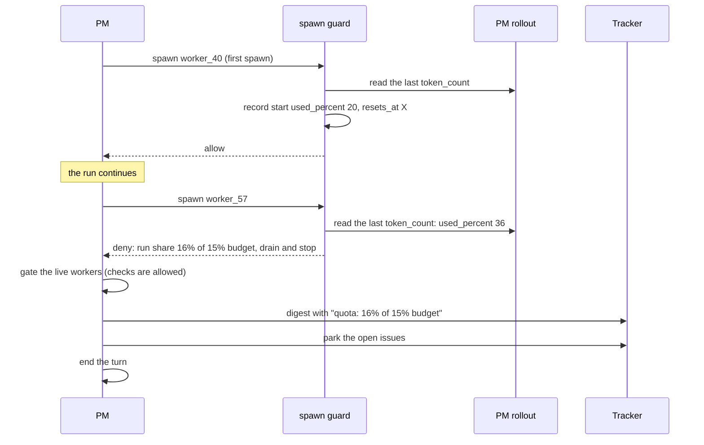
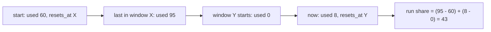

## Purpose

This feature lets the operator see and limit the quota of a PM run. It changes the built
feature [Loop operations](03-loop-operations.md): the run configuration, the digest, and
the spawn guard.

The run that [Quota use of an operator run](../pages/spend-analysis.md) records used about
1.35 weekly quotas in 5.5 days, and nothing stopped it. The operator found out from the
ChatGPT usage page. This feature adds two parts:

1. **A usage report.** `scripts/usage.py` reads the local Codex rollout files and prints
   the tokens of each thread and the quota share of the run. It ports upstream
   `scripts/usage.py` (0.21.0), which reads Claude Code transcripts.
2. **A run budget.** An optional setting, off by default. The suggested value is 15% of the
   weekly quota. When the run has
   used its budget, the spawn guard refuses new workers. The PM gates the workers that are
   live, posts the digest, parks the rest, and ends the session.

## User stories

- As the operator, I want a limit on the quota of one run, so that I do not come back to a used quota and little work.
- As the operator, I want to turn the limit off or change it, so that a large planned run can use more.
- As the operator, I want each digest to show the quota that the run used, so that I see the cost while the run is live.
- As the maintainer, I want a report of the tokens of each thread, so that I can find the next cost problem from data.

## Functional requirements

### Usage report

- FR-run-budget-1 — `scripts/usage.py` reads rollout files under `$CODEX_HOME/sessions/`, or `~/.codex/sessions/` when `CODEX_HOME` is not set.
- FR-run-budget-2 — `scripts/usage.py --session <id>` reports every rollout whose `session_meta.session_id` or `session_meta.id` is `<id>`.
- FR-run-budget-3 — `scripts/usage.py --cwd <dir> --since <ISO time>` reports every rollout whose `session_meta.cwd` is `<dir>` and that has an event at or after `<ISO time>`.
- FR-run-budget-4 — The report has one row for each thread: role, `agent_path`, model, model calls, input tokens, cached input tokens, output tokens, and reasoning tokens.
- FR-run-budget-5 — The report takes each thread's totals from its last `token_count` event.
- FR-run-budget-6 — The report shows the role `root` for a thread whose `session_meta` has no `parent_thread_id`.
- FR-run-budget-7 — The report adds one row for each role and one `TOTAL` row.
- FR-run-budget-8 — The report shows the quota share of the run, computed by the rules in "Quota share" below.
- FR-run-budget-9 — `scripts/usage.py --json` prints the same report as one JSON object with the keys `threads`, `by_role`, `totals`, and `quota`.
- FR-run-budget-10 — `scripts/usage.py` skips a line that is not JSON and counts it in `totals.skipped_lines`.
- FR-run-budget-11 — `scripts/usage.py` makes no network call.

### Quota share

- FR-run-budget-12 — The quota share uses `rate_limits.primary.used_percent` and `rate_limits.primary.resets_at` from the `token_count` events of the root thread.
- FR-run-budget-13 — Within one value of `resets_at`, the share is the last `used_percent` minus the first `used_percent`.
- FR-run-budget-14 — When `resets_at` changes, the share adds the share of the previous window to the share of the new window. The new window starts from 0.
- FR-run-budget-15 — When the root thread has no `rate_limits`, the quota share is `null`, and the report says "no quota data".

### Run budget setting

- FR-run-budget-16 — `.issue-flow.codex.json` holds `runBudgetPercent`: an integer from 1 to 100, or `null` for no budget.
- FR-run-budget-17 — The default of `runBudgetPercent` is `null`: no budget.
- FR-run-budget-18 — When the operator turns the budget on without a value, the PM saves `runBudgetPercent: 15`.
- FR-run-budget-19 — The run configuration question shows `runBudgetPercent` with the saved value marked, the option `off`, and the option `15`.
- FR-run-budget-20 — An answer of `off` saves `runBudgetPercent: null`.

### Enforcement

- FR-run-budget-21 — The spawn guard reads the PM rollout from the `transcript_path` of the PM spawn payload.
- FR-run-budget-22 — At the first PM spawn of a session, the spawn guard records the start `used_percent` and `resets_at` in `$PLUGIN_DATA/budget-<session_id>.json`.
- FR-run-budget-23 — The spawn guard computes the run share from the recorded start and the last `token_count` event of the rollout, by the quota share rules.
- FR-run-budget-24 — The spawn guard reads at most the last 1 MiB of the rollout to find the last `token_count` event.
- FR-run-budget-25 — When the run share is equal to or more than `runBudgetPercent`, the spawn guard denies each PM spawn of `issue_worker` and `explorer`.
- FR-run-budget-26 — When the budget is reached, the spawn guard still allows `criteria_checker`, `ci_watcher`, and `deploy_verifier`, so that live work can finish its gate.
- FR-run-budget-27 — The deny reason states the run share, the budget, and the drain steps: gate the live workers, post the digest, park the open issues, and end the turn.
- FR-run-budget-28 — When `runBudgetPercent` is `null`, or the rollout has no `rate_limits`, the spawn guard applies no budget rule.

### PM behaviour

- FR-run-budget-29 — Each digest has the line `quota: <run share>% of <budget>% budget`, or `quota: <run share>%, no budget`.
- FR-run-budget-30 — When the spawn guard denies a spawn for the budget, the PM launches no new work. It gates each live worker, posts the digest, and ends its turn.
- FR-run-budget-31 — The PM treats an operator message about spare tokens as no change to the budget. The PM changes the budget only when the operator names a new value.

## User flows

### Flow 1 — The budget stops a run



1. At the first PM spawn, the spawn guard records the start quota.
2. At each later PM spawn, the guard computes the run share.
3. If the share is equal to or more than the budget, the guard denies worker and explorer spawns.
4. The PM gates each live worker. Checker and watcher spawns stay allowed.
5. The PM posts the digest with the quota line.
6. The PM parks the open issues and ends its turn.

### Flow 2 — The quota window resets during a run



1. The run starts at 60% in window X.
2. Window X ends at 95%.
3. Window Y starts at 0%.
4. The share is the sum of both window shares.

## Screens & states

The feature has no screens. The report is terminal text:

```text
role              agent_path              model         calls   input M  cached M  output M
root              /root                   gpt-6.1-sol   16805   3670.1   3625.3    11.48
issue_worker      /root/worker_168_c13    gpt-6.1-sol     100      8.7      8.5     0.09
...
TOTAL                                                     76k   9892.3   9729.0    36.43
quota: 135.0% of the weekly limit (2 windows)
```

## Behaviour rules

- The budget is a share of the weekly quota of the operator's account. Other Codex sessions of the same account during the run count against it, because `used_percent` is account-wide.
- The guard fails open: a missing rollout, a parse error, or a missing `rate_limits` field applies no budget rule.
- The usage report reads files only. It never changes a rollout.
- The report has no cost column. A ChatGPT plan has no published price per token.

## Data touched

- `scripts/usage.py` (new port file), `tests/test_usage.py`, recorded rollout fixtures under `tests/fixtures/rollouts/`.
- `hooks/guard-spawn.py`, `$PLUGIN_DATA/budget-<session_id>.json` (new).
- `.issue-flow.codex.json`: new key `runBudgetPercent`.
- `skills/issue-flow/SKILL.md`: run configuration, digest, and the stop rule.

## Interfaces

- **Rollout files:** `$CODEX_HOME/sessions/<yyyy>/<mm>/<dd>/rollout-<time>-<id>.jsonl`. Line types used: `session_meta` (`id`, `session_id`, `parent_thread_id`, `cwd`, `agent_role`, `agent_path`), `turn_context` (`model`), and `event_msg` with `payload.type: "token_count"` (`info.total_token_usage`, `rate_limits.primary.used_percent`, `rate_limits.primary.window_minutes`, `rate_limits.primary.resets_at`). Verified against: 896 rollout files of codex-cli 0.167.1, read on 2026-11-21 (codex-harness fact 30).
- **`transcript_path` in a PreToolUse payload:** the absolute path of the session rollout. Verified against: `tests/fixtures/hooks/pre_tool_use_wait.json` and `pre_tool_use_spawn.json` (codex-cli 0.166.0).
- **Upstream usage report:** `scripts/usage.py` at `issue-flow--v0.21.0`: the flags `--session`, `--since`, `--json`, and the per-agent row.

## Edge cases & failures

- If the PM spawns its first subagent late in a session, the start value comes from the rollout at that spawn. The planner spawns of the same session do not count, and Feature 07 tells the operator to start a new session.
- If two PM sessions of one account run at the same time, each guard sees the quota use of both. The budget then stops both sooner. The digest line shows the share.
- If the rollout format changes, the guard applies no budget rule, and the usage report counts the skipped lines. The conformance suite has a probe that reads one `token_count` event.
- If `used_percent` decreases while `resets_at` stays the same, the guard uses 0 for that window share.

## Acceptance criteria

- [ ] On a recorded rollout fixture, `usage.py --json` reports the totals of the last `token_count` event of each thread. (FR-run-budget-4, 5, 9)
- [ ] A fixture thread with no `parent_thread_id` shows role `root`. (FR-run-budget-6)
- [ ] A fixture with a `resets_at` change from 60-95 to 0-8 reports a quota share of 43. (FR-run-budget-13, 14)
- [ ] A fixture with a broken line reports `skipped_lines: 1`. (FR-run-budget-10)
- [ ] A recorded PM spawn of `issue_worker`, with a rollout 16 points above the recorded start and a budget of 15, gets a deny decision whose reason names the drain steps. (FR-run-budget-23, 25, 27)
- [ ] In the same state, a PM spawn of `criteria_checker` gets no budget deny. (FR-run-budget-26)
- [ ] With `runBudgetPercent: null`, the same spawn of `issue_worker` gets no budget deny. (FR-run-budget-28)
- [ ] The guard reads no more than 1 MiB of a 50 MiB rollout fixture, and finishes in less than 1 s. (FR-run-budget-24)
- [ ] The run configuration question in the skill text lists `runBudgetPercent` with default `off` and the option `15`, and a saved file with no `runBudgetPercent` applies no budget. (FR-run-budget-17, 18, 19)
- [ ] On the test bed, a run with `runBudgetPercent: 1` stops after the budget, posts a digest with the `quota:` line, and leaves no worker live. (FR-run-budget-29, 30)

## Out of scope

- A budget in hours or in issues. `runLength` already limits the issue count.
- A budget for the project-review PM. It uses the same spawn guard, so the rule applies, but no review-specific text changes.

## Open questions

- None.
