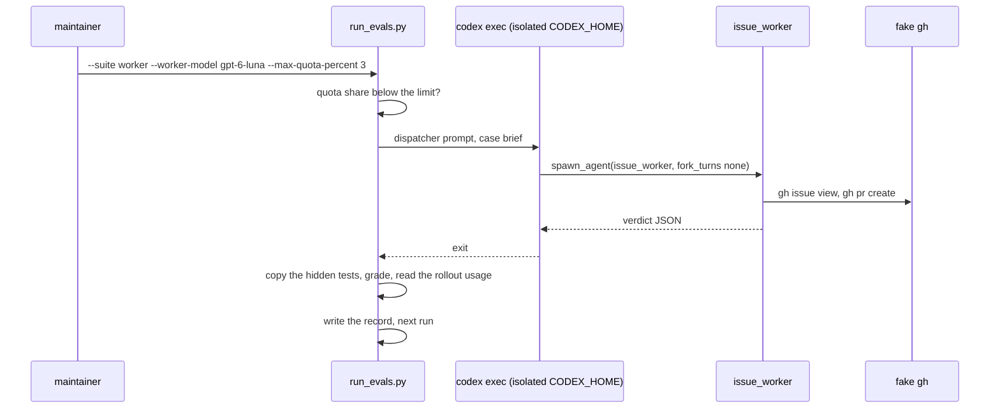
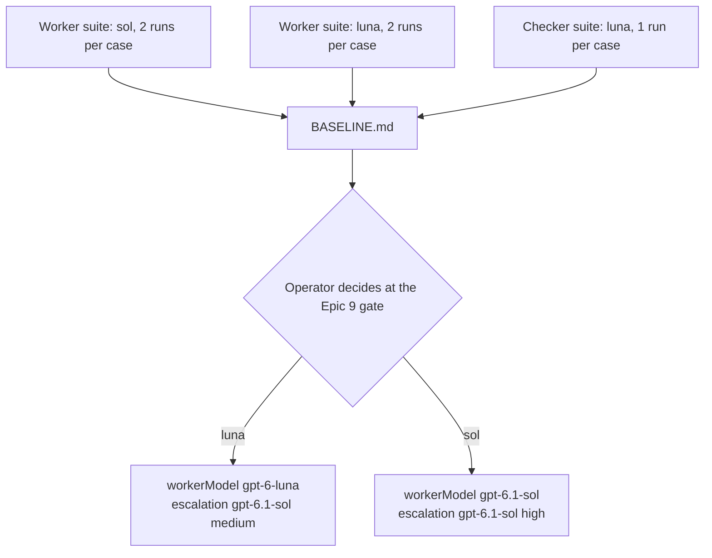

## Purpose

This feature measures `gpt-6-luna` against `gpt-6.1-sol` as the worker model. The result
decides the default `workerModel`.

Upstream moved its worker from Opus to Sonnet after an eval: on 8 cases with 3 runs each,
Sonnet passed the hidden tests on 21 of 21 runs, at 72% lower cost
(Sniper7Kills-LLC/claude-plugins#109). The Codex models are different, so the port needs
its own numbers. The operator does not know the code quality of `gpt-6-luna`, and asked
for a test before a change.

The eval reuses the upstream worker cases. Each case holds a small project, one tracker
issue, hidden tests, and a reference patch. The cases are MIT-licensed, the same as the
plugin. The port adds a runner on `codex exec`.

This feature is `port-only`. The upstream evals live outside the plugin directory, in
`evals/` and `scripts/run-evals.py`, and run on `claude -p`.

## User stories

- As the operator, I want the worker model chosen from measured results, so that a cheaper model does not cost more in rework.
- As the operator, I want the eval to stop at a quota limit, so that the test itself cannot use my plan.
- As the maintainer, I want the eval results committed, so that a later model change compares against them.

## Functional requirements

### Cases

- FR-worker-model-eval-1 — `evals/worker/` holds the 11 upstream worker cases of `issue-flow--v0.21.0`, with `_fixture/` and `_fixture_large/`.
- FR-worker-model-eval-2 — `evals/checker/` holds the upstream criteria checker cases of `issue-flow--v0.21.0`.
- FR-worker-model-eval-3 — `evals/README.md` names the upstream source, the tag, and the MIT license of the cases.
- FR-worker-model-eval-4 — Each case keeps the upstream `case.json` graders: `hidden_tests`, `verdict`, `diff_scope`, and `gh_log`.
- FR-worker-model-eval-5 — The port replaces each case `prompt` with a Codex dispatcher prompt that spawns one `issue_worker` with `fork_turns: "none"` and the case brief.
- FR-worker-model-eval-6 — A unit test applies each `reference.patch` to its fixture and proves that the hidden tests pass.

### Runner

- FR-worker-model-eval-7 — `scripts/run_evals.py --suite worker|checker` runs each case in a new temporary directory.
- FR-worker-model-eval-8 — The runner creates an isolated `CODEX_HOME` for each run. It links `auth.json` from the operator's Codex home and never copies it.
- FR-worker-model-eval-9 — The runner writes the role files of the working tree into the isolated `CODEX_HOME/agents/`.
- FR-worker-model-eval-10 — `--worker-model <id>` sets `model` in the isolated copy of `roles/issue-worker.toml`.
- FR-worker-model-eval-11 — `--worker-effort <level>` sets `model_reasoning_effort` in the same copy.
- FR-worker-model-eval-12 — The runner puts the upstream fake `gh` first on `PATH`, so that no run reaches a real forge.
- FR-worker-model-eval-13 — The runner starts each run with `codex exec`, `-c approval_policy="never"`, and stdin closed (codex-harness fact 11).
- FR-worker-model-eval-14 — The runner copies the hidden tests into the run directory only after the agent has finished.
- FR-worker-model-eval-15 — The runner grades each run with the case graders and writes one record to `evals/results/<UTC time>/results.json`.
- FR-worker-model-eval-16 — Each record holds the case, the run number, the worker model, the effort, each grader result, the outcome, the duration, and the `usage.py` totals of the run's rollouts.
- FR-worker-model-eval-17 — The runner writes `summary.json` with the pass rate of the hidden tests, the mean input tokens, and the mean output tokens for each case and for the suite.

### Quota limit

- FR-worker-model-eval-18 — `--max-quota-percent 
` stops the runner before a new run when the quota share since the runner started is equal to or more than `
`.
- FR-worker-model-eval-19 — The runner computes the quota share with the rules of Feature 09, from the rollouts of its own runs.
- FR-worker-model-eval-20 — The default of `--max-quota-percent` is 3.
- FR-worker-model-eval-21 — When the limit stops the runner, `summary.json` has `"partial": true` and the stop reason.

### Decision

- FR-worker-model-eval-22 — The maintainer runs the worker suite once with `gpt-6.1-sol` at effort `medium` and once with `gpt-6-luna` at effort `medium`, with 2 runs for each case.
- FR-worker-model-eval-23 — The maintainer runs the checker suite once with `gpt-6-luna` at effort `medium`, with 1 run for each case.
- FR-worker-model-eval-24 — The results go to `evals/candidates/<issue>-worker-model/<suite>-<model>/`, committed.
- FR-worker-model-eval-25 — `evals/BASELINE.md` states, for each model: the hidden-test pass rate, the mean input tokens, the mean output tokens, and the cases that failed.
- FR-worker-model-eval-26 — The operator decides the default `workerModel` at the batch gate of Epic 9. The spec records the decision in the `Models` table and the `Changelog`.
- FR-worker-model-eval-27 — When the operator chooses `gpt-6-luna`, the default escalation becomes `gpt-6.1-sol` at effort `medium` (Feature 08).
- FR-worker-model-eval-28 — When the checker pass rate on the checker suite is below 100%, the epic gate records a question for the operator about the checker model.

## User flows

### Flow 1 — One eval run

1. The maintainer starts the runner with a suite, a model, and a quota limit.
2. Before each run, the runner checks the quota share.
3. The runner starts `codex exec` with the dispatcher prompt.
4. The dispatcher spawns one worker with the case brief.
5. The worker builds the issue against the fake `gh` and returns its verdict.
6. The runner copies in the hidden tests, grades the run, and records the usage.

### Flow 2 — Choose the worker model

1. The maintainer runs three suites and writes `BASELINE.md`.
2. The operator reads the pass rates and the token counts.
3. The operator chooses the worker model.
4. The escalation default follows the choice.

## Screens & states

The feature has no screens.

## Behaviour rules

- The eval budget is part of the operator's limit for live Codex runs in Epics 7 to 9: 10% of the weekly quota in total. Each runner invocation has a default limit of 3%.
- The eval never runs in CI. It uses the operator's quota.
- One run at a time. The machine limit is 3 concurrent background workers, and one `codex exec` run with its worker uses two threads.
- A case that the upstream runner tagged `large` runs after the small cases, so that a stop by the quota limit keeps the small-case results.

## Data touched

- `evals/` (new): cases, fixtures, the fake `gh`, `README.md`, `BASELINE.md`, `candidates/`.
- `scripts/run_evals.py` (new), `tests/test_run_evals.py`.
- `.gitignore`: `evals/results/`.

## Interfaces

- **`codex exec`:** has no `-a` flag and waits for stdin unless stdin is closed. Verified against: codex-harness fact 11.
- **Isolated `CODEX_HOME`:** roles load from `$CODEX_HOME/agents/`. Verified against: codex-harness fact 26.
- **Worker spawn in `codex exec`:** a V2 spawn of a custom role returns its JSON. Verified against: codex-harness fact 4.
- **Upstream cases:** `evals/worker/*/case.json` and `evals/checker/*/case.json` at `issue-flow--v0.21.0` in `Sniper7Kills-LLC/claude-plugins`.

## Edge cases & failures

- If a run has no verdict JSON, the `verdict` grader fails, and the record keeps the last message.
- If a worker sandbox denies a command that the case needs, the record marks the run `error`, not `fail`. The summary counts errors apart from failures.
- If the fake `gh` gets a command that it does not know, it exits 1 and logs the call. The `gh_log` grader reads the log.
- If the quota data is missing from the rollouts, the runner stops before the second run and asks for `--max-quota-percent off`.

## Acceptance criteria

- [ ] `python3 -m unittest tests.test_run_evals` passes, and each `reference.patch` makes its hidden tests pass. (FR-worker-model-eval-1, 6)
- [ ] The runner never writes to the operator's `~/.codex/`, and a test checks that `auth.json` in the isolated home is a symbolic link. (FR-worker-model-eval-8)
- [ ] One smoke run of `worker-easy-negative-qty` on `gpt-6-luna` writes a record with grader results and token totals. (FR-worker-model-eval-15, 16)
- [ ] A test with a fake rollout above the limit shows that the runner stops and writes `"partial": true`. (FR-worker-model-eval-18, 21)
- [ ] `evals/BASELINE.md` holds the pass rate and the mean tokens of both worker models and the checker. (FR-worker-model-eval-22 to 25)
- [ ] The `Models` table in `spec.md` names the chosen worker model and cites the candidate results. (FR-worker-model-eval-26)

## Out of scope

- The upstream PM suite. The PM cases depend on Claude Code notifications.
- A model change for the PM.

## Open questions

- None.
