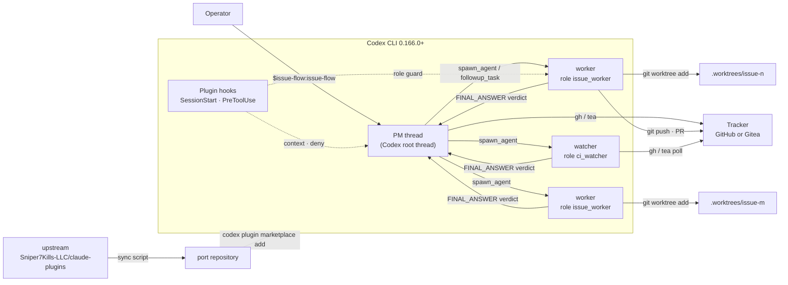
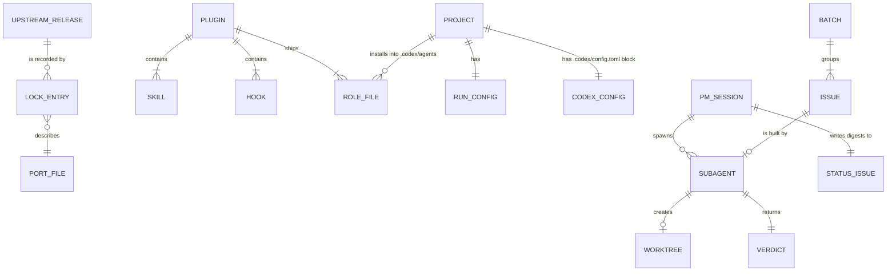

# issue-flow for Codex

## Overview

issue-flow is a Claude Code plugin by sniper7kills (MIT license). Its upstream
repository is `Sniper7Kills-LLC/claude-plugins`. The plugin drives an autonomous
development loop from tracker issues on GitHub or Gitea. A PM skill triages the
tracker, groups issues into batches, and starts background workers. Each worker
builds one issue in its own git worktree and returns a verdict.

This project ports issue-flow to the OpenAI Codex CLI harness as a native Codex
plugin. The operator uses Codex as a second model provider. The operator wants the
same loop, the same tracker state, and the same seven skills in Codex.

The port is possible now. A live test on Codex 0.166.0 (2026-11-03) confirmed the
harness parts that the loop needs: plugin skills, plugin hooks, custom agent roles,
multi-agent V2 spawn and wait, and git writes from a sandboxed worker. The page
[Codex harness facts](pages/codex-harness.md) records each fact and its evidence. The
page [Porting inventory](pages/porting-inventory.md) maps every upstream file to its
port action.

## Terms

| Term | Part of speech | Meaning in this project | Do not use |
|---|---|---|---|
| upstream | noun | The Claude Code issue-flow plugin in `Sniper7Kills-LLC/claude-plugins`, at a release tag. | original, source plugin, parent |
| port | noun | This project: the Codex version of issue-flow. | fork, clone, variant |
| port (to) | verb | To change an upstream file so that it works in Codex. | convert, migrate, translate |
| harness | noun | The agent program that runs the model and its tools: Codex CLI or Claude Code. | runtime, host, client |
| Codex | noun | The OpenAI Codex CLI harness, `codex` binary, version 0.166.0 or later. | Codex app, OpenAI CLI |
| plugin | noun | The installable Codex package that holds the skills, the hooks, and the scripts. | extension, add-on |
| skill | noun | One `SKILL.md` procedure that the operator starts with `$issue-flow:<name>`. | command, prompt, slash command |
| role | noun | One Codex custom agent definition: a TOML file in `.codex/agents/`. | agent type, subagent type, persona |
| PM | noun | The main Codex thread that runs the issue-flow skill and makes every decision. | orchestrator, lead, coordinator |
| worker | noun | A subagent of role `issue_worker` that builds one issue. | child, helper, subtask |
| watcher | noun | A subagent of role `ci_watcher` that waits for one CI run or one deployment and returns a verdict. | monitor, poller |
| subagent | noun | Any thread that a `spawn_agent` call creates. | child agent, sub-thread |
| thread slot | noun | One unit of the Codex limit on concurrent threads in a session. The PM uses one. | seat, lane |
| verdict | noun | The JSON object that a worker or a watcher returns as its final answer. | result, report, output |
| worktree | noun | A git worktree that one worker creates for one issue, under `.worktrees/`. | sandbox, checkout copy |
| permission profile | noun | A Codex `[permissions.<name>]` table that sets file and network access for the session. | sandbox config, policy |
| spawn guard | noun | The PreToolUse hook that denies an unsafe `spawn_agent` call. | spawn hook, fork guard |
| role guard | noun | The PreToolUse hook that denies a tool call that a role must not make. | tool filter, allowlist hook |
| hook trust | noun | The Codex record that the operator approved a hook at its current content hash. | hook approval, allow |
| setup skill | noun | The skill `$issue-flow:setup` that writes the Codex configuration into a project. | installer, bootstrap |
| sync | verb | To copy upstream changes into the port by the rules in `upstream.lock`. | merge upstream, rebase |
| upstream lock | noun | The file `upstream.lock` that records the upstream tag and the port mode of each file. | manifest, provenance file |
| port mode | noun | One of `verbatim`, `patched`, `rewritten`, `dropped`, or `new`: how a file relates to upstream. | sync type, status |
| conformance suite | noun | The scripted live checks that prove a Codex version still has the harness parts the port uses. | smoke test, spike |
| test bed | noun | A throwaway repository on GitHub or Gitea that the end-to-end tests run against. | sandbox repo, playground |
| tracker | noun | The issue tracker of the forge: GitHub Issues or Gitea Issues. | backlog tool, board |
| forge | noun | GitHub or Gitea. | host, git server |
| co-operator | noun | A second PM session, in either harness, that works the same tracker. | peer, teammate |
| batch | noun | A group of issues that share one integration branch and one CI run. | bundle, wave |
| digest | noun | The periodic status comment that the PM posts on its status issue. | report, summary |

## Goals

1. An operator runs the full issue-flow loop in Codex with `$issue-flow:issue-flow`. The loop triages, plans, builds, gates, merges, and watches deployments.
2. All seven upstream skills work in Codex: `issue-flow`, `spec-to-issues`, `project-planner`, `project-inherit`, `spec-update`, `project-review`, and `repo-mirror`.
3. All five upstream roles work in Codex: `issue_worker`, `ux_explorer`, `deploy_verifier`, `review_scribe`, and `code_auditor`.
4. A project stays compatible with upstream: a Claude Code PM and a Codex PM can work the same tracker as co-operators.
5. The loop runs with a permission profile, not with `danger-full-access`.
6. The port syncs each upstream release in one working session or less, because shared files are copied by a script.
7. The conformance suite tells the operator within one run if a Codex release removes a harness part that the port uses.

## Non-goals

- The port does not use an external orchestrator script. The PM runs inside Codex. [ADR 0001](../adr/0001-native-plugin.md) records this decision.
- The port does not support Claude models in Codex. Codex runs OpenAI models.
- The port does not change upstream tracker formats: labels, markers, status issues, and `.issue-flow.json` keep the upstream schema.
- The port does not support the Codex desktop app or the Codex cloud in v1. The target is the Codex CLI.
- The port does not ship provider integrations for deployment. Upstream does not ship them either.

## Users & personas

| Persona | Needs | Can do |
|---|---|---|
| Operator | Runs the loop in Codex on own projects. Wants the same results as upstream. | Installs the plugin, runs the setup skill, starts skills, answers questions, approves reviews. |
| Maintainer | Keeps the port current with upstream and with new Codex releases. | Runs the sync, runs the conformance suite, merges port changes. |
| Co-operator | Runs upstream issue-flow in Claude Code on the same tracker. | Works the same issues. Sees the same labels and status issues. |
| Contributor | Proposes a change to the port through a pull request. | Opens issues and pull requests on the public repository. |

## Feature map

| Feature set | Spec file | Epic | Mockups |
|---|---|---|---|
| Foundation | [00-foundation](features/00-foundation.md) | Epic 0 | none |
| Plugin packaging and hooks | [01-plugin-packaging](features/01-plugin-packaging.md) | Epic 1 | none |
| Worker dispatch | [02-worker-dispatch](features/02-worker-dispatch.md) | Epic 2 | none |
| Loop operations | [03-loop-operations](features/03-loop-operations.md) | Epic 3 | none |
| Spec skills | [04-spec-skills](features/04-spec-skills.md) | Epic 4 | none |
| Project review | [05-project-review](features/05-project-review.md) | Epic 5 | none |
| Mirror and sync | [06-mirror-and-sync](features/06-mirror-and-sync.md) | Epic 6 | none |

The port is a command-line plugin. It has no screens, so the spec has no mockups.

## Architecture & stack

### Plugin package

- **Manifest:** `.codex-plugin/plugin.json`, in the legacy manifest format. The Agent Plugin format (root `plugin.json` with `$schema`) loads no hooks in Codex 0.166.0, so the port does not use it. Verified against: source `codex-rs/core-plugins/src/loader.rs:985-997` (commit `dbaead01`) and the live test in [Codex harness facts](pages/codex-harness.md).
- **Marketplace:** `.agents/plugins/marketplace.json`, the Codex path. The port does not use `.claude-plugin/marketplace.json`, because Claude Code reads that path and would offer a plugin that does not work in Claude Code. Verified against: source `codex-rs/core-plugins/src/marketplace.rs:20-25`.
- **Skills:** `skills/<name>/SKILL.md`. Codex names them `issue-flow:<name>`. The operator types `$issue-flow:<name>`. Verified against: live test (skill listed as `spikeplug:ping`).
- **Roles:** Codex plugins cannot carry roles. The plugin ships role files under `roles/`. The setup skill copies them into the project's `.codex/agents/`. Verified against: source `codex-rs/core-plugins/src/manifest.rs:48-117` (no `agents` field).
- **Hooks:** `hooks/hooks.json`. Hook commands use `$PLUGIN_ROOT`. Verified against: live test (`PLUGIN_ROOT` set to the install cache path).
- **Scripts:** Python 3 standard library only, the same as upstream. No package install step.

Why a native plugin beat an external orchestrator: an external script would duplicate the PM logic in code, and the upstream skill text would stop being the source of truth. The live test showed that V2 `wait_agent` gives the PM a working event loop. [ADR 0001](../adr/0001-native-plugin.md).

### Multi-agent model

- The port uses multi-agent V2. Current models select V2 through the model catalog, and no setting forces V1 on them. Verified against: `codex debug models --bundled` (0.166.0), source `codex-rs/core/src/config/mod.rs:1687-1714`.
- The PM always spawns with `fork_turns: "none"`. A full fork copies the whole PM context into the subagent. Upstream measured that this copy makes the subagent run the PM loop by itself.
- The PM reads a verdict from the `FINAL_ANSWER` message that Codex queues after `wait_agent` returns. `wait_agent` itself returns no content. Verified against: live test (two verdicts received).
- The PM ends its turn only when the loop stops. Codex does not start a new PM turn when a subagent finishes while the PM is idle (`wake_on_agent_messages` is under development). Verified against: source `codex-rs/core/src/session/handlers.rs:89-99`.

### Thread slots

- Codex counts the PM in its thread limit. The default limit is 4, so the default gives 3 subagent slots.
- The setup skill sets `[features.multi_agent_v2] max_concurrent_threads_per_session` to `concurrency + 4`. That gives one slot per worker, one watcher slot, two slots for worker subagents, and the PM.
- A worker subagent and a watcher use the same pool as the workers. The PM counts all live subagents with `list_agents` before each spawn.

### Sandbox

- The setup skill writes a permission profile `issue_flow` that extends `:workspace`, makes `.git` writable, and enables network access. Verified against: live test (worktree add, commit, and `git ls-remote` all exit 0 under this profile, and all fail under the default `workspace-write`).
- Subagents inherit the profile from the PM. Verified against: live test (a `git_worker` subagent created a worktree and committed).
- [ADR 0003](../adr/0003-permission-profile.md) records the decision.

### Models

| Thread | Default model | Reason |
|---|---|---|
| PM | `gpt-6.1-sol` | The docs call it the "Latest workhorse". The PM makes every decision. |
| worker | `gpt-6.1-sol`, effort `medium` | A worker writes production code. The operator can lower it in the run configuration. |
| watcher, code_auditor, worker subagents | `gpt-6-luna` | The docs call it the "most efficient model for focused, high-volume tasks". |

Verified against: `codex debug models --bundled` (0.166.0), https://learn.chatgpt.com/docs/models (retrieved 2026-11-03). The operator changes any model in `.issue-flow.json` (Feature 03).

### Upstream tracking

The repository keeps upstream files in the same paths as upstream. `upstream.lock` records the upstream tag and the port mode of each file. The sync script copies `verbatim` files. It writes a change list for the other files. [ADR 0002](../adr/0002-separate-repo-tracks-upstream.md).

## Data model

| Entity | Fields | Constraints | Lifecycle |
|---|---|---|---|
| UPSTREAM_RELEASE | `tag` (string, for example `issue-flow--v0.17.0`), `commit` (SHA) | One current release per lock. | Changes on each sync. |
| LOCK_ENTRY | `path` (repo-relative), `mode` (`verbatim` \| `patched` \| `rewritten` \| `dropped` \| `new`), `upstream_sha256` (hash of the upstream file at the tag), `notes` (string) | One entry per upstream file and per new file. `verbatim` files must hash equal to upstream. | The sync script updates `upstream_sha256`. A person changes `mode`. |
| PORT_FILE | `path`, content | Lives at the upstream path when one exists. | Changed by pull requests. |
| PLUGIN | `name` = `issue-flow`, `version` (semver, port-own) | `version` is independent of upstream. | Released from `main`. |
| SKILL | `name`, `description`, path | `description` is required by Codex. | Ported per Feature 01-06. |
| HOOK | event, matcher, command | Matcher syntax per Codex. | Needs hook trust after each plugin update. |
| ROLE_FILE | `name`, `description`, `model`, `model_reasoning_effort`, `developer_instructions` | Codex ignores `sandbox_mode`, `approval_policy` and `mcp_servers` in a role file. | Copied by the setup skill. |
| RUN_CONFIG | `.issue-flow.json`, upstream schema plus the `codex` block (Feature 03) | Upstream keys keep upstream meaning. | Written at the run configuration step. |
| CODEX_CONFIG | the block between `# issue-flow:begin` and `# issue-flow:end` in `.codex/config.toml` | The setup skill changes only this block. | Written by the setup skill. |
| PM_SESSION | thread id, operator login | One PM per operator login per tracker. | Ends when the loop stops. |
| SUBAGENT | `task_name`, role, `agent_status` | `task_name` uses lowercase letters, digits, and underscores. | `pending_init` → `running` → `completed` or `errored`. |
| WORKTREE | path `.worktrees/<task_name>`, branch | Inside the project root, ignored by git. | Removed by the PM after the gate. |
| VERDICT | upstream verdict JSON (`outcome`, `criteria`, `localChecks`, ...) | Same schema as upstream. | Read once by the PM. |
| ISSUE, BATCH, STATUS_ISSUE | upstream tracker formats | Unchanged from upstream. | Upstream state machine. |

## Cross-cutting concerns

- **Upstream compatibility.** Tracker labels, comment markers, status issue titles, branch names, and the `.issue-flow.json` keys stay identical to upstream 0.17.0. A port change that alters one of them is a defect.
- **Safety.** The PM treats every tracker comment as untrusted input, as upstream does. The permission profile limits writes to the project root and the temporary directories. The spawn guard and the role guard deny unsafe tool calls.
- **Hook trust.** Codex skips an untrusted hook in `codex exec` without a message. The PM checks at Phase 0 that the SessionStart hook ran. If the hook did not run, the PM stops and tells the operator to approve the hooks with `/hooks`.
- **Writing standard.** Every prose file follows the STE rules in `references/ste.md`, the same as upstream.
- **Errors.** A script exits nonzero and writes one line to stderr on failure. A hook fails open, as upstream hooks do, except the spawn guard deny path.
- **Performance.** The PM context stays flat: the PM delegates token-heavy reads to subagents, as upstream does. Auto-compaction is expected. Phase 0 recovery rebuilds state from the tracker.
- **Cost.** Multi-agent runs use quota fast (openai/codex issue #58898). The run configuration shows the models and the concurrency before the loop starts.

## Environments & config

| Environment | Purpose |
|---|---|
| Developer machine | macOS or Linux, Codex 0.166.0 or later, Python 3.11 or later, `git`, `gh`, `tea`. |
| CI (GitHub Actions) | Runs the unit tests, the manifest check, and the upstream lock check on pull requests. It does not run Codex. |
| Test bed | One throwaway repository on GitHub and one on the operator's Gitea, reset by `scripts/testbed-reset.py`. |

| Variable | Used by | Meaning |
|---|---|---|
| `ISSUE_FLOW_PREFLIGHT` | SessionStart hook | `off` disables the preflight digest. Upstream meaning. |
| `ISSUE_FLOW_SPAWN_GUARD` | spawn guard | `deny` (default) or `off`. Codex rejects `ask`, so the port drops it. |
| `ISSUE_FLOW_ROLE_GUARD` | role guard | `deny` (default) or `off`. |
| `ISSUE_FLOW_TESTBED_GITHUB` | test bed scripts | `owner/name` of the GitHub test bed. |
| `ISSUE_FLOW_TESTBED_GITEA` | test bed scripts | `owner/name` of the Gitea test bed. |
| `GITEA_SERVER_URL` | test bed scripts, `tea` | The Gitea base URL. |

Secrets: the forge tokens live in the `gh` and `tea` credential stores. No file in the repository holds a token. `docs/external.md` lists names only.

## Testing strategy

- **Unit tests:** `python3 -m unittest discover -s tests`. They cover every script and hook with recorded hook payloads. The payloads come from the live test, for example `tool_name: "collaborationspawn_agent"`.
- **Manifest check:** `python3 scripts/validate_manifests.py` checks the plugin manifest, the marketplace file, every `SKILL.md` front-matter, and every role file.
- **Lock check:** `python3 scripts/upstream_sync.py --check` fails when a `verbatim` file differs from upstream.
- **Conformance suite:** `python3 scripts/conformance.py` runs live `codex exec` probes in an isolated `CODEX_HOME`. It proves each harness fact that the port uses. It uses the operator's Codex login and quota, so CI does not run it. The maintainer runs it on each new Codex release.
- **End-to-end tests:** the maintainer runs a scripted loop on each test bed. The test bed holds a small app and five seeded issues. The run passes when the loop merges one batch and closes its issues.
- **Done for a change:** unit tests pass, the manifest check passes, the lock check passes, and the change states which upstream file and section it ports.

## Epics

| Epic | Goal | Feature files | Depends on | Exit criteria |
|---|---|---|---|---|
| Epic 0: Foundation | The repository, the upstream import, the tests, CI, the conformance suite, and the test beds exist. | 00-foundation | none | A fresh clone runs the unit tests and the lock check green. The conformance suite passes on Codex 0.166.0. |
| Epic 1: Plugin packaging and hooks | The plugin installs in Codex, the setup skill configures a project, and the hooks work. | 01-plugin-packaging | Epic 0 | `codex plugin add issue-flow@issue-flow-codex` succeeds. The setup skill writes the roles and the config block. Both guards deny their test cases. |
| Epic 2: Worker dispatch | The PM spawns workers in worktrees, reads verdicts, and gates sub-merges. | 02-worker-dispatch | Epic 1 | On a test bed, the PM builds a two-member batch and sub-merges both members. |
| Epic 3: Loop operations | Phase 0, CI and deployment watchers, digests, compaction recovery, and co-operator compatibility work. | 03-loop-operations | Epic 2 | A full end-to-end run passes on both test beds. |
| Epic 4: Spec skills | The four spec skills run in Codex and write a Codex scaffold. | 04-spec-skills | Epic 1 | `$issue-flow:project-planner` produces an approved spec package on a test project. |
| Epic 5: Project review | The review PM and the four review roles run in Codex. | 05-project-review | Epic 3 | `$issue-flow:project-review` files findings and lands a manual PR on a test bed. |
| Epic 6: Mirror and sync | `repo-mirror` works, the upstream sync is automated, and v0.1.0 ships. | 06-mirror-and-sync | Epic 4, Epic 5 | A scheduled CI job opens an issue for a new upstream tag. The marketplace serves v0.1.0. |

## Milestones

1. **M0 — Foundation (Epic 0).** Shippable means: the repository holds upstream 0.17.0 with a complete lock, and the conformance suite passes.
2. **M1 — Installable (Epic 1).** Shippable means: an operator installs the plugin and runs the setup skill.
3. **M2 — Core loop (Epics 2 and 3).** Shippable means: the loop builds and merges a batch on both forges. From M2, the port can build its own later epics.
4. **M3 — Full parity (Epics 4 and 5).** Shippable means: all seven skills run in Codex.
5. **M4 — Release (Epic 6).** Shippable means: v0.1.0 is in the marketplace and the upstream sync runs on a schedule.

## Assumptions

- The operator runs the PM in the interactive Codex TUI. `codex exec` is used by the conformance suite and the end-to-end scripts only.
- The PM turn can last for hours. Codex compacts the context inside the turn. The live test did not run a turn this long; Epic 3 measures it.
- The first port release tracks upstream `issue-flow--v0.17.0`.
- The default models are the ones in the model table. The operator can change them.
- A worktree lives at `.worktrees/<task_name>` inside the project root. The permission profile makes only the project root writable, and upstream uses `.claude/worktrees/` for the same reason.
- One operator login runs one PM per tracker at a time, in either harness. Upstream keys the status issue on the login, so two PMs with one login would write the same status issue. The maintainer confirmed this limit for v1 on 2026-11-03.

## Risks & open questions

- **Long PM turn.** The loop needs the PM turn to stay alive across many `wait_agent` calls and several compactions. Codex issues #45343 and #47592 report delegated tasks lost or repeated after compaction. Mitigation: Phase 0 recovery from the tracker, plus a `list_agents` check after each SessionStart with `source: compact` (Feature 03). Epic 3 measures it.
- **Hook trust after each update.** Codex pins plugin hook trust to a hash of the whole plugin. Each plugin update disables the hooks until the operator approves them again. Mitigation: the PM checks at Phase 0 that the hooks ran (Feature 01).
- **Codex changes fast.** The release notes from 0.129.0 to 0.166.0 show renamed tools and changed defaults. For example, 0.137.0 renamed `assign_task` to `followup_task`. Mitigation: the conformance suite (Feature 00).
- **Documentation and source disagree.** The plugin docs say plugin hooks work "only for plugins installed manually in Codex desktop". The live test showed plugin hooks running in the CLI. The port relies on the observed behavior and the conformance suite checks it.
- **Quota.** Concurrency 3 with `gpt-6.1-sol` workers can use a large share of a ChatGPT plan. The operator decides the worker model at each run.

## Issue map

Created by spec-to-issues on 2026-11-03 in `Crank-Git/issue-flow-codex`.

| Epic | Epic issue | Sub-issues |
|---|---|---|
| Epic 0: Foundation | #1 | #8, #9, #10, #11, #12 |
| Epic 1: Plugin packaging and hooks | #2 | #13, #14, #15, #16, #17, #18 |
| Epic 2: Worker dispatch | #3 | #19, #20, #21, #22, #23 |
| Epic 3: Loop operations | #4 | #24, #25, #26, #27, #28, #29 |
| Epic 4: Spec skills | #5 | #30, #31, #32, #33, #34 |
| Epic 5: Project review | #6 | #35, #36, #37, #38 |
| Epic 6: Mirror and sync | #7 | #39, #40, #41, #42 |

| Requirements | Issue |
|---|---|
| FR-foundation-1, FR-foundation-2, FR-foundation-3, FR-foundation-4, FR-foundation-5, FR-foundation-6, FR-foundation-7, FR-foundation-8 | #8 |
| FR-foundation-9, FR-foundation-10, FR-foundation-11, FR-foundation-12 | #9 |
| FR-foundation-13, FR-foundation-14, FR-foundation-15, FR-foundation-16, FR-foundation-17 | #10 |
| FR-foundation-18, FR-foundation-19, FR-foundation-20 | #11 |
| FR-foundation-21, FR-foundation-22, FR-foundation-23 | #12 |
| FR-plugin-packaging-1, FR-plugin-packaging-2, FR-plugin-packaging-3, FR-plugin-packaging-4, FR-plugin-packaging-5, FR-plugin-packaging-6, FR-plugin-packaging-7, FR-plugin-packaging-8, FR-plugin-packaging-9 | #13 |
| FR-plugin-packaging-10, FR-plugin-packaging-11, FR-plugin-packaging-12, FR-plugin-packaging-13, FR-plugin-packaging-14, FR-plugin-packaging-15, FR-plugin-packaging-16, FR-plugin-packaging-19 | #14 |
| FR-plugin-packaging-17, FR-plugin-packaging-18, FR-plugin-packaging-20, FR-plugin-packaging-21, FR-plugin-packaging-22 | #15 |
| FR-plugin-packaging-23, FR-plugin-packaging-26, FR-plugin-packaging-27, FR-plugin-packaging-28, FR-plugin-packaging-39 | #16 |
| FR-plugin-packaging-24, FR-plugin-packaging-29, FR-plugin-packaging-30, FR-plugin-packaging-31, FR-plugin-packaging-32, FR-plugin-packaging-33 | #17 |
| FR-plugin-packaging-25, FR-plugin-packaging-34, FR-plugin-packaging-35, FR-plugin-packaging-36, FR-plugin-packaging-37, FR-plugin-packaging-38 | #18 |
| FR-worker-dispatch-1, FR-worker-dispatch-2, FR-worker-dispatch-3, FR-worker-dispatch-4, FR-worker-dispatch-5, FR-worker-dispatch-6, FR-worker-dispatch-7 | #19 |
| FR-worker-dispatch-12, FR-worker-dispatch-13, FR-worker-dispatch-14, FR-worker-dispatch-15, FR-worker-dispatch-34, FR-worker-dispatch-35, FR-worker-dispatch-36 | #20 |
| FR-worker-dispatch-8, FR-worker-dispatch-9, FR-worker-dispatch-10, FR-worker-dispatch-11, FR-worker-dispatch-16, FR-worker-dispatch-17, FR-worker-dispatch-18 | #21 |
| FR-worker-dispatch-19, FR-worker-dispatch-20, FR-worker-dispatch-21, FR-worker-dispatch-22, FR-worker-dispatch-23, FR-worker-dispatch-24, FR-worker-dispatch-25, FR-worker-dispatch-26, FR-worker-dispatch-27 | #22 |
| FR-worker-dispatch-28, FR-worker-dispatch-29, FR-worker-dispatch-30, FR-worker-dispatch-31, FR-worker-dispatch-32, FR-worker-dispatch-33 | #23 |
| FR-loop-operations-1, FR-loop-operations-2, FR-loop-operations-3, FR-loop-operations-4, FR-loop-operations-5, FR-loop-operations-6, FR-loop-operations-7 | #24 |
| FR-loop-operations-8, FR-loop-operations-9, FR-loop-operations-10, FR-loop-operations-11, FR-loop-operations-12, FR-loop-operations-13, FR-loop-operations-35 | #25 |
| FR-loop-operations-15, FR-loop-operations-16, FR-loop-operations-17, FR-loop-operations-18 | #26 |
| FR-loop-operations-14, FR-loop-operations-19, FR-loop-operations-20, FR-loop-operations-21, FR-loop-operations-22, FR-loop-operations-23, FR-loop-operations-24, FR-loop-operations-25 | #27 |
| FR-loop-operations-26, FR-loop-operations-27, FR-loop-operations-28, FR-loop-operations-34, FR-loop-operations-36 | #28 |
| FR-loop-operations-29, FR-loop-operations-30, FR-loop-operations-31, FR-loop-operations-32, FR-loop-operations-33 | #29 |
| FR-spec-skills-1, FR-spec-skills-2, FR-spec-skills-3, FR-spec-skills-4, FR-spec-skills-5, FR-spec-skills-6 | #30 |
| FR-spec-skills-7, FR-spec-skills-8, FR-spec-skills-9, FR-spec-skills-10, FR-spec-skills-11, FR-spec-skills-14, FR-spec-skills-18 | #31 |
| FR-spec-skills-12, FR-spec-skills-13, FR-spec-skills-15, FR-spec-skills-16, FR-spec-skills-17 | #32 |
| FR-spec-skills-19, FR-spec-skills-20, FR-spec-skills-21 | #33 |
| FR-spec-skills-22, FR-spec-skills-23, FR-spec-skills-24, FR-spec-skills-25 | #34 |
| FR-project-review-1, FR-project-review-2, FR-project-review-3, FR-project-review-7, FR-project-review-8 | #35 |
| FR-project-review-4, FR-project-review-5, FR-project-review-6 | #36 |
| FR-project-review-9, FR-project-review-10, FR-project-review-11, FR-project-review-12, FR-project-review-13, FR-project-review-14 | #37 |
| FR-project-review-15 | #38 |
| FR-mirror-and-sync-1, FR-mirror-and-sync-2, FR-mirror-and-sync-3, FR-mirror-and-sync-4, FR-mirror-and-sync-5 | #39 |
| FR-mirror-and-sync-6, FR-mirror-and-sync-7, FR-mirror-and-sync-8, FR-mirror-and-sync-9 | #40 |
| FR-mirror-and-sync-10, FR-mirror-and-sync-11, FR-mirror-and-sync-12 | #41 |
| FR-mirror-and-sync-13, FR-mirror-and-sync-14, FR-mirror-and-sync-15 | #42 |

## Changelog

- 2026-11-03 — First draft. Interview rounds 1-3 settled: separate repository that tracks upstream; all seven skills in v1; GitHub and Gitea; dev-and-live; public; live test before the sandbox decision; top-tier PM with lower-tier subagents; test beds on both forges; plugin plus setup skill; both harnesses build this repository; plugin name `issue-flow`; tracker compatibility with upstream. Live test on Codex 0.166.0 confirmed the permission profile approach.
- 2026-11-03 — Review round 1: approved. The maintainer confirmed one PM per login for v1, the default models (`gpt-6.1-sol` for the PM and workers, `gpt-6-luna` for helpers), and the scaffold proposal.
- 2026-11-03 — Epic 0 batch gate (PR #50). The Gitea test bed moved from the stale `testgitea` login to `e/issue-flow-codex-testbed` on `https://telescope.lan` (operator decision). The operator deferred the live Gitea reset to #49, because the `telescope` token has no issue scope. The reset script now refuses a repository whose name does not end in `-testbed`.
